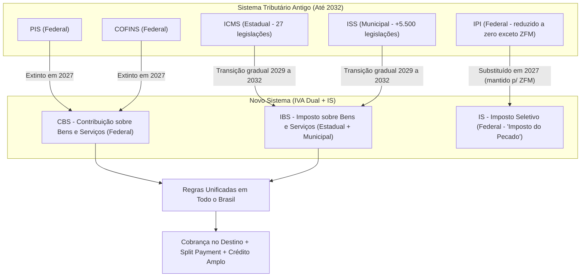

# 📘 Guia Mestre: Tudo Sobre a Reforma Tributária no Brasil

> **Fonte Legal de Referência:** Emenda Constitucional nº 132/2023 (EC 132/2023) e Lei Complementar nº 214/2025 (originada do PLP 68/2024), que regulamenta o Imposto sobre Bens e Serviços (IBS), a Contribuição sobre Bens e Serviços (CBS) e o Imposto Seletivo (IS).
>
> *Nota de Escopo (Engenharia de Qualidade de Software): Este repositório foi estruturado de forma didática, com diagramas, fórmulas matemáticas explícitas e exemplos executáveis para aprendizado, documentação de negócios e especificação de regras fiscais/ERP. Para consultoria jurídica ou contábil formal, consulte um advogado tributarista ou contador.*

---

## 🌐 Versões Interativas em HTML (Portais Visuais + Calculadoras ao Vivo)

Para visualizar os diagramas coloridos, tabelas comparativas expandidas e usar a **Calculadora Interativa em JavaScript** direto no navegador, abra os arquivos `.html` abaixo:

- **[`curso-completo-reforma-tributaria.html`](./curso-completo-reforma-tributaria.html)** — **🎓 Curso Completo Passo a Passo (Apostila Digital HTML do Zero ao Avançado em 8 Módulos + Simulador de Cadeia Produtiva + Quiz Interativo)**
- **[`index.html`](./index.html)** — **Portal Mestre Interativo da Reforma Tributária (Todas as 7 Etapas)**
- **[`etapa-07-construcao-civil-exemplos-praticos/construcao-civil-reforma-tributaria.html`](./etapa-07-construcao-civil-exemplos-praticos/construcao-civil-reforma-tributaria.html)** — **Dossiê HTML Detalhado da Construção Civil (Os 5 Perfis + 3 Exemplos Práticos + Simulador ao Vivo de Incorporação e Obras)**

---

## 🧭 Mapa de Navegação por Etapas

Este repositório está organizado em **7 etapas progressivas** para você aprender do zero até a aplicação prática e o cálculo matemático:

1. **Etapa 01 — O Que Muda (Antes e Depois)**
   - [`01-problema-sistema-antigo.md`](./etapa-01-o-que-muda-antes-e-depois/01-problema-sistema-antigo.md): Por que o modelo antigo (PIS, COFINS, IPI, ICMS e ISS) gerava efeito cascata e guerra fiscal.
   - [`02-novo-modelo-iva-dual.md`](./etapa-01-o-que-muda-antes-e-depois/02-novo-modelo-iva-dual.md): A chegada do **IVA Dual** (**CBS** + **IBS**) e do **Imposto Seletivo (IS)**.
2. **Etapa 02 — Como Funciona na Prática**
   - [`01-nao-cumulatividade-e-creditos.md`](./etapa-02-como-funciona-na-pratica/01-nao-cumulatividade-e-creditos.md): Cálculo "por fora", não cumulatividade plena e desenho da cadeia produtiva.
   - [`02-split-payment-e-cobranca-no-destino.md`](./etapa-02-como-funciona-na-pratica/02-split-payment-e-cobranca-no-destino.md): O que é **Split Payment** (divisão automática no pagamento) e a tributação no destino.
   - [`03-cashback-e-cesta-basica.md`](./etapa-02-como-funciona-na-pratica/03-cashback-e-cesta-basica.md): Devolução de tributos (**Cashback**) para baixa renda e **Cesta Básica Nacional** com alíquota zero.
3. **Etapa 03 — Cronograma de Transição (2026 a 2033)**
   - [`01-linha-do-tempo-completa.md`](./etapa-03-cronograma-transicao-2026-2033/01-linha-do-tempo-completa.md): O que acontece em cada ano, começando pela alíquota-teste de 1% em 2026 até a extinção total do ICMS/ISS em 2033.
4. **Etapa 04 — Onde se Aplica (Impacto por Setor e Regime)**
   - [`01-simples-nacional-e-mei.md`](./etapa-04-onde-se-aplica-por-setor/01-simples-nacional-e-mei.md): Como ficam o **Simples Nacional**, o **MEI** e a escolha entre pagar por dentro do DAS ou por fora para gerar créditos B2B.
   - [`02-servicos-comercio-industria.md`](./etapa-04-onde-se-aplica-por-setor/02-servicos-comercio-industria.md): Aplicações práticas na Indústria, no Comércio, nos Serviços e para Profissionais Liberais.
   - [`03-regimes-diferenciados-e-especificos.md`](./etapa-04-onde-se-aplica-por-setor/03-regimes-diferenciados-e-especificos.md): Reduções de 100%, 60% e 30% (Saúde, Educação, Agro, Imóveis, Combustíveis, Financeiro).
5. **Etapa 05 — Exemplos Práticos e Cálculos**
   - [`01-simulacoes-passo-a-passo.md`](./etapa-05-exemplos-praticos-e-calculos/01-simulacoes-passo-a-passo.md): Simulações matemáticas detalhadas com desenhos em texto e memória de cálculo.
   - [`simulador_reforma.py`](./etapa-05-exemplos-praticos-e-calculos/simulador_reforma.py): Script Python interativo para simular créditos de IVA Dual, Split Payment e reduções de alíquota.
6. **Etapa 06 — Impacto em Sistemas, NF-e e Qualidade de Software (QA)**
   - [`01-adequacao-nf-erp-e-testes-qa.md`](./etapa-06-impacto-em-sistemas-e-qa/01-adequacao-nf-erp-e-testes-qa.md): Novos campos de documentos fiscais eletrônicos, arquitetura de motor fiscal (ISO/IEC 25010:2023) e casos de teste (ISTQB CTFL 4.0).
7. **Etapa 07 — Construção Civil: Guia Setorial e 3 Exemplos Práticos Completos**
   - [`01-guia-setorial-construcao-civil.md`](./etapa-07-construcao-civil-exemplos-praticos/01-guia-setorial-construcao-civil.md): Regras para **Incorporadora, Construtora, Empreiteira, Administradora de Obras e Especialistas/Serviços Complementares** (LC 214/2025).
   - [`02-tres-exemplos-praticos-completos.md`](./etapa-07-construcao-civil-exemplos-praticos/02-tres-exemplos-praticos-completos.md): 3 simulações completas com desenhos, fluxogramas e memória de cálculo de toda a cadeia da obra.
   - [`simulador_construcao_civil.py`](./etapa-07-construcao-civil-exemplos-praticos/simulador_construcao_civil.py): Simulador executável em Python dos 3 exemplos da Construção Civil.

---

## 🎨 Visão Geral em Um Único Desenho (Antes vs. Depois)

```text
+-------------------------------------------------------------------------+
|                  COMO ERA (5 TRIBUTOS SOBRE O CONSUMO)                  |
+-------------------------------------------------------------------------+
|                                                                         |
|   [ PIS ]       [ COFINS ]       [ IPI ]        [ ICMS ]       [ ISS ]  |
|  (Federal)      (Federal)       (Federal)      (Estadual)    (Municipal)|
|      |              |               |              |              |     |
|      +--------------+---------------+              +--------------+     |
|                     |                                     |             |
|                     v                                     v             |
|    +---------------------------------+   +-------------------------+    |
|    |         CBS + IS (União)        |   |  IBS (Estados/Municíp.) |    |
|    +---------------------------------+   +-------------------------+    |
|                     \                                     /             |
|                      \                                   /              |
|                       v                                 v               |
|                  +-------------------------------------------+          |
|                  |       NOVO MODELO: IVA DUAL + IS          |          |
|                  |  - Cálculo "por fora" (transparente)      |          |
|                  |  - Cobrança no destino (onde consome)     |          |
|                  |  - Crédito amplo (sem efeito cascata)     |          |
|                  +-------------------------------------------+          |
+-------------------------------------------------------------------------+
```

---

## 🔄 Fluxograma Geral da Reforma Tributária



---

## 📌 Resumo Rápido: Onde a Reforma se Aplica e Onde NÃO se Aplica?

| Categoria | Tributos Afetados | Onde se Aplica? |
| :--- | :--- | :--- |
| **Tributos sobre o Consumo (Foco da EC 132/2023)** | PIS, COFINS, IPI, ICMS, ISS $\rightarrow$ viram **CBS, IBS e IS** | Compras e vendas de mercadorias, serviços, locações, licenciamentos, importações e operações com bens materiais e imateriais. |
| **Patrimônio (Mudanças na EC 132/2023)** | IPVA, ITCMD, IPTU | **IPVA:** passa a incidir sobre jatos, helicópteros, iates e lanchas.<br>**ITCMD (Herança/Doação):** passa a ser obrigatoriamente progressivo conforme o valor.<br>**IPTU:** prefeituras podem atualizar base de cálculo por decreto conforme critérios da lei municipal. |
| **Renda e Folha (Fora da EC 132/2023)** | IRPF, IRPJ, CSLL, INSS Patronal, FGTS | **Não mudam com a EC 132/2023.** Continuam seguindo suas regras próprias (eventuais mudanças dependem de projetos de lei específicos sobre a renda). |
