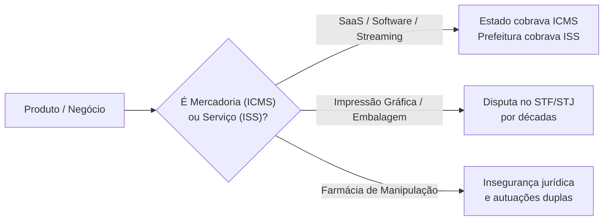

# Etapa 01.1 — O Problema do Sistema Antigo

> **Base Conceitual:** Diagnóstico do Sistema Tributário Nacional anterior à Emenda Constitucional nº 132/2023.

Para entender **por que** a Reforma Tributária foi aprovada, precisamos primeiro enxergar como funcionavam os **5 tributos sobre o consumo** no Brasil e por que eles tornavam o país um dos mais complexos do mundo para calcular impostos.

---

## 1. Os 5 Tributos Antigos Sobre o Consumo

Antes da Reforma, sempre que uma empresa produzia, vendia um produto ou prestava um serviço, ela lidava com até cinco tributos diferentes, cobrados por três esferas de governo (União, Estados e Municípios):

| Tributo | Sigla | Quem Cobrava? | Sobre o que incidia? | Principal Problema |
| :--- | :--- | :--- | :--- | :--- |
| **Programa de Integração Social** | **PIS** | União (Federal) | Faturamento / Receita das empresas | Dois regimes (cumulativo e não cumulativo) e milhares de disputas judiciais sobre o que dá direito a crédito. |
| **Contribuição para o Financiamento da Seguridade Social** | **COFINS** | União (Federal) | Faturamento / Receita das empresas | Mesma base do PIS, mas alíquotas diferentes e regras complexas de monofasia e substituição. |
| **Imposto sobre Produtos Industrializados** | **IPI** | União (Federal) | Produtos saídos da indústria ou importados | Tabela TIPI com milhares de classificações (NCM) e dúvidas sobre o que é industrialização vs. serviço. |
| **Imposto sobre Circulação de Mercadorias e Serviços** | **ICMS** | Estados e DF (27 UFs) | Mercadorias, transporte interestadual, energia e telecom | **27 legislações diferentes**, Substituição Tributária (ICMS-ST), cálculo "por dentro" e guerra fiscal. |
| **Imposto Sobre Serviços** | **ISS** | Municípios (+5.570 cidades) | Lista de serviços (LC 116/2003) | **Cumulativo** (gera imposto em cascata), mais de 5.500 leis municipais e conflito com o ICMS (ex.: software, streaming). |

---

## 2. Os 4 Grandes Defeitos do Modelo Antigo

### A) Cálculo "Por Dentro" (Falta de Transparência)
No modelo antigo (especialmente no ICMS, PIS e COFINS), o imposto entrava na **própria base de cálculo dele mesmo**.

**Fórmula do Cálculo "Por Dentro":**
$$\text{Preço com Imposto} = \frac{\text{Preço Líquido}}{1 - \text{Alíquota Nominal}}$$

$$\text{Alíquota Efetiva Real} = \frac{\text{Alíquota Nominal}}{1 - \text{Alíquota Nominal}}$$

* **Exemplo com dados reais:** Se a alíquota nominal do ICMS era de $18\%$ ($0{,}18$) sobre um produto de $\text{R\$ } 82{,}00$ líquidos:
  $$\text{Preço Final} = \frac{82{,}00}{1 - 0{,}18} = \frac{82{,}00}{0{,}82} = \text{R\$ } 100{,}00$$
  $$\text{Imposto Pago} = \text{R\$ } 18{,}00 \quad \Rightarrow \quad \text{Sobre os R\$ } 82{,}00\text{ do produto, isso equivale a } \frac{18}{82} = \mathbf{21{,}95\%}\text{!}$$

O consumidor achava que pagava $18\%$, mas na realidade pagava **$21{,}95\%$** sobre o valor líquido da mercadoria.

---

### B) Efeito Cascata (Cumulatividade e Créditos Restritos)
No sistema antigo, vigorava o chamado **crédito físico**: uma fábrica só podia abater o imposto da matéria-prima que entrava fisicamente no produto final. Se ela comprasse material de escritório, software de gestão, consultoria, publicidade ou mobiliário, **não podia descontar o imposto pago** nessas compras. Além disso, o **ISS** (serviços) não gerava crédito algum.

#### Desenho do "Imposto em Cascata" (Antes da Reforma)

```text
[1. Prestador de Serviço TI] 
   Vende software por R$ 1.000 + R$ 50 de ISS = R$ 1.050
          |
          |  (O ISS de R$ 50 NÃO gera crédito para a fábrica!)
          v
[2. Indústria de Alimentos]
   O custo de R$ 1.050 vira custo embutido no preço do biscoito.
   A indústria cobra ICMS/PIS/COFINS em cima dos R$ 1.050 (imposto sobre imposto!).
          |
          v
[3. Consumidor Final]
   Paga o imposto da ponta + os resíduos de impostos escondidos no meio da cadeia!
```

---

### C) Guerra Fiscal (Cobrança na Origem)
Grande parte do ICMS e do ISS ficava no **Estado ou Município de origem** (onde a fábrica ou sede da empresa estava instalada), e não onde o consumidor morava.
* **Consequência:** Estados disputavam fábricas e centros de distribuição dando descontos artificiais de ICMS ("benefícios fiscais"). Empresas abriam galpões em estados distantes apenas para pagar menos imposto, fazendo caminhões rodarem milhares de quilômetros a mais sem necessidade logística real.

---

### D) Conflito de Competência: "É Mercadoria ou é Serviço?"
Como Estados cobravam **ICMS** (mercadorias) e Municípios cobravam **ISS** (serviços), qualquer produto moderno gerava anos de processos judiciais:



---

## 3. Onde Esse Problema se Aplicava?
* **Nas empresas:** O Brasil chegou ao topo dos rankings mundiais de horas gastas para apurar tributos (cerca de 1.500 horas/ano em empresas médias/grandes) e bilhões de reais bloqueados em contencioso tributário.
* **Nas exportações:** Como nem todo imposto pago ao longo da cadeia gerava crédito, os produtos brasileiros exportados carregavam "resíduos tributários", perdendo competitividade no exterior.
* **No consumidor final:** Preços opacos, em que ninguém sabia exatamente quanto estava pagando de tributo em um pão, em uma conta de luz ou em uma mensalidade escolar.
