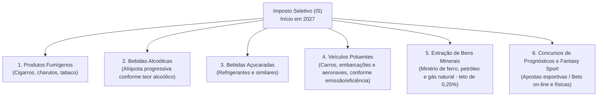

# Etapa 01.2 — O Novo Modelo: IVA Dual (CBS + IBS) e Imposto Seletivo (IS)

> **Base Legal:** Emenda Constitucional nº 132/2023 (arts. 153, VIII, 156-A e 195, V da Constituição Federal) e Lei Complementar nº 214/2025.

A Reforma Tributária substitui os 5 tributos antigos sobre o consumo (**PIS, COFINS, IPI, ICMS e ISS**) por um modelo adotado por mais de 170 países: o **IVA (Imposto sobre Valor Agregado)**.

Como o Brasil é uma Federação (União, Estados e Municípios possuem autonomia), foi criado o **IVA Dual** (dividido em duas partes gêmeas) mais um imposto regulatório (**Imposto Seletivo**).

---

## 1. Os 3 Novos Tributos explicados de forma simples

```text
+-----------------------------------------------------------------------------+
|                        OS 3 NOVOS TRIBUTOS DO BRASIL                        |
+-----------------------------------------------------------------------------+
|                                                                             |
|  1. CBS (Contribuição sobre Bens e Serviços)                                |
|     - Competência: UNIÃO (Governo Federal)                                  |
|     - Substitui: PIS, COFINS e parte do IPI                                 |
|                                                                             |
|  2. IBS (Imposto sobre Bens e Serviços)                                     |
|     - Competência: ESTADOS + MUNICÍPIOS (Gerido pelo Comitê Gestor do IBS)  |
|     - Substitui: ICMS (Estadual) e ISS (Municipal)                          |
|                                                                             |
|  3. IS (Imposto Seletivo - apelidado de "Imposto do Pecado")                |
|     - Competência: UNIÃO (Governo Federal)                                  |
|     - Função: Extrafiscal (desestimular produtos prejudiciais à saúde       |
|       e ao meio ambiente)                                                   |
|                                                                             |
+-----------------------------------------------------------------------------+
```

---

## 2. Por que CBS e IBS são chamados de "Tributos Gêmeos" (IVA Dual)?

Embora a **CBS** vá para o caixa do Governo Federal e o **IBS** vá para o caixa dos Estados e Municípios, a Constituição (art. 149-B da CF/88, incluído pela EC 132/2023) determina que **ambos possuem exatamente as mesmas regras**:

1. **Mesmo fato gerador:** Incidem sobre operações com bens materiais ou imateriais, inclusive direitos, ou com serviços (acabou a briga entre "é mercadoria ou é serviço?").
2. **Mesma base de cálculo:** O valor da operação, calculado **"por fora"** (CBS e IBS não entram na base um do outro nem na própria base).
3. **Mesmas hipóteses de não cumulatividade e creditamento:** O que dá crédito de CBS também dá crédito de IBS.
4. **Mesmos regimes diferenciados:** Se um setor (como Saúde ou Educação) tem redução de $60\%$ na alíquota, a redução vale igualmente para a CBS e para o IBS.

---

## 3. Como é formada a Alíquota do IVA Dual?

A soma da CBS com o IBS forma a alíquota total do IVA Dual:

$$\text{Alíquota Total do IVA} = \text{Alíquota}_{\text{CBS}} + \left(\text{Alíquota}_{\text{IBS Estadual}} + \text{Alíquota}_{\text{IBS Municipal}}\right)$$

* Cada Estado e cada Município pode fixar sua própria alíquota de referência por lei, mas **para todos os produtos de uma vez** (um estado ou município não pode escolher dar desconto só para carros ou só para sapatos — as reduções de $30\%$, $60\%$ ou $100\%$ são nacionais, definidas na Lei Complementar).
* **Trava de Alíquota Padrão (LC 214/2025):** A lei estabelece uma trava de avaliação para buscar manter a alíquota padrão de referência (estimada em torno de $26{,}5\%$ a $28\%$, sendo aproximadamente $\sim 8{,}8\%$ de CBS e $\sim 17{,}7\%$ de IBS, sujeita à calibragem oficial durante a transição com base nos dados reais arrecadados).

---

## 4. O que é o Imposto Seletivo (IS) e onde ele se aplica?

O **Imposto Seletivo (IS)** não foi criado para arrecadar em cima de tudo, mas sim para sobretaxar bens e serviços **prejudiciais à saúde ou ao meio ambiente** (por isso o apelido de *"Imposto do Pecado"*).

### Onde o Imposto Seletivo se aplica (LC 214/2025)?



### Regras de ouro do Imposto Seletivo (IS):
* **Incidência monofásica (uma única vez):** Exceto em casos específicos (como apostas/comercialização), nos produtos industriais ele incide uma única vez (na saída da fábrica, na extração ou na importação).
* **Não incide nas exportações** nem sobre energia elétrica e telecomunicações.
* **Integra a base de cálculo do IBS e da CBS:** Quando um produto tem Imposto Seletivo (ex.: cigarro ou bebida alcoólica), o valor do IS entra na base sobre a qual serão calculados a CBS e o IBS.

---

## 5. E o que acontece com o IPI?

O **IPI (Imposto sobre Produtos Industrializados)** não é formalmente extinto da Constituição, mas a partir de **2027**:
1. **Sua alíquota é reduzida a ZERO ($0\%$)** para quase todos os produtos fabricados no Brasil.
2. **Exceção da Zona Franca de Manaus (ZFM):** O IPI continuará sendo cobrado **apenas** sobre produtos fabricados em outras regiões do Brasil (ou importados) que concorram com bens industrializados na **Zona Franca de Manaus** (conforme critérios de industrialização local da LC 214/2025), para preservar a competitividade constitucional do polo industrial de Manaus até 2073.
