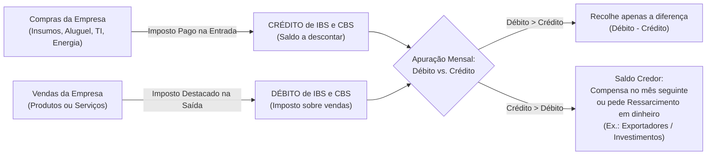

# Etapa 02.1 — Não Cumulatividade Plena e Cálculo "Por Fora"

> **Base Legal:** Art. 156-A, § 1º, VIII e IX da Constituição Federal (EC 132/2023) e arts. 47 a 57 da Lei Complementar nº 214/2025.

Esta é a mudança mais importante para o dia a dia das empresas: **como o imposto é calculado na nota fiscal** e **o que dá direito a crédito tributário**.

---

## 1. O Cálculo "Por Fora" (Transparência Total)

Diferente do antigo ICMS/PIS/COFINS (que eram calculados "por dentro"), o **IBS** e a **CBS** são calculados **"por fora"**, exatamente como o IVA europeu ou o *Sales Tax* norte-americano.

### Fórmula Matemática do Cálculo "Por Fora"

$$\text{Valor do Tributo} = \text{Base de Cálculo (Preço Líquido)} \times \text{Alíquota}$$

$$\text{Valor Total da Nota Fiscal} = \text{Base de Cálculo} + \text{CBS} + \text{IBS}$$

* **Exemplo Prático (supondo alíquota total ilustrativa de $27\%$, sendo $9\%$ CBS e $18\%$ IBS):**
  - Preço líquido da mercadoria/serviço: $\text{R\$ } 1.000{,}00$
  - $\text{CBS } (9\%) = 1.000{,}00 \times 0{,}09 = \text{R\$ } 90{,}00$
  - $\text{IBS } (18\%) = 1.000{,}00 \times 0{,}18 = \text{R\$ } 180{,}00$
  - $\text{Total cobrado do comprador} = 1.000{,}00 + 90{,}00 + 180{,}00 = \mathbf{\text{R\$ } 1.270{,}00}$

---

## 2. Não Cumulatividade Plena (Crédito Financeiro Amplo)

### O que significa "Não Cumulatividade Plena"?
Significa que **toda aquisição de bem ou serviço paga pela empresa na sua atividade econômica gera crédito de IBS e CBS**, exceto o que a lei classificar como **uso ou consumo pessoal** (ex.: joias, bebidas alcoólicas para diretores, bens de lazer).

```text
+-------------------------------------------------------------------------+
|        O QUE PASSA A GERAR CRÉDITO (CRÉDITO FINANCEIRO AMPLO)           |
+-------------------------------------------------------------------------+
| [V] Matéria-prima, insumos e embalagens                                 |
| [V] Mercadorias compradas para revenda                                  |
| [V] Energia elétrica, água, internet e telecomunicações da empresa      |
| [V] Aluguel do escritório, galpão ou loja                               |
| [V] Software (SaaS), nuvem, serviços de TI, marketing e contabilidade   |
| [V] Material de escritório, limpeza, EPIs e fretes                      |
| [V] Máquinas, equipamentos e veículos de trabalho (Ativo Imobilizado)   |
|                                                                         |
| [X] O QUE NÃO GERA CRÉDITO:                                             |
|     - Bens/serviços de uso e consumo pessoal (lazer, estética, joias)   |
|     - Folha de salários (CLT/funcionários não têm incidência de IVA)    |
|     - Compras isentas/alíquota zero (se não pagou imposto na entrada,   |
|       não há imposto para creditar)                                     |
+-------------------------------------------------------------------------+
```

---

## 3. Desenho Passo a Passo: Como o Imposto Caminha na Cadeia Produtiva

Vamos acompanhar a produção e venda de uma **Mesa de Madeira**, usando uma alíquota ilustrativa de **$25\%$ de IVA Dual (CBS + IBS)** para visualizar a matemática com clareza:

```text
================================================================================
ETAPA 1: MADEIREIRA vende madeira para a FÁBRICA DE MÓVEIS
================================================================================
  Preço líquido da madeira:  R$ 100,00
  (+) IVA Dual (25%):        R$  25,00
  (=) Total da Nota Fiscal:  R$ 125,00
  ----------------------------------------------------------------------------
  -> Governo recebe nesta etapa: R$ 25,00
  -> Fábrica guarda um CRÉDITO de: R$ 25,00

================================================================================
ETAPA 2: FÁBRICA transforma a madeira em mesa e vende para a LOJA (VAREJO)
================================================================================
  Preço líquido da mesa:     R$ 300,00   (Agregou R$ 200,00 de valor)
  (+) IVA Dual (25%):        R$  75,00   (Débito na venda = 300 x 25%)
  (=) Total da Nota Fiscal:  R$ 375,00
  ----------------------------------------------------------------------------
  Cálculo do imposto que a Fábrica paga ao Governo:
  Débito nas vendas (R$ 75,00) - Crédito da madeira (R$ 25,00) = R$ 50,00
  -> Governo recebe nesta etapa: R$ 50,00
  -> Loja guarda um CRÉDITO de: R$ 75,00

================================================================================
ETAPA 3: LOJA vende a mesa para o CONSUMIDOR FINAL (Pessoa Física)
================================================================================
  Preço líquido no varejo:   R$ 500,00   (Agregou R$ 200,00 de valor)
  (+) IVA Dual (25%):        R$ 125,00   (Débito na venda = 500 x 25%)
  (=) Total pago no caixa:   R$ 625,00
  ----------------------------------------------------------------------------
  Cálculo do imposto que a Loja paga ao Governo:
  Débito nas vendas (R$ 125,00) - Crédito da fábrica (R$ 75,00) = R$ 50,00
  -> Governo recebe nesta etapa: R$ 50,00

================================================================================
RESUMO FINAL DA CADEIA:
================================================================================
  Soma do que o Governo arrecadou: R$ 25,00 + R$ 50,00 + R$ 50,00 = R$ 125,00
  Imposto pago pelo Consumidor Final (25% de R$ 500,00):          = R$ 125,00
  -> ZERO imposto em cascata! Cada elo pagou 25% APENAS sobre o valor que agregou!
```

---

## 4. Fluxograma da Apuração de Créditos e Débitos



### Condição Essencial para Tomar o Crédito (Novidade da Reforma!)
No sistema antigo, bastava ter a Nota Fiscal de compra para se creditar, o que alimentava fraudes com "notas frias".
Na **Reforma Tributária (LC 214/2025)**, a regra geral é que **o crédito do comprador está vinculado à extinção (pagamento) do tributo na etapa anterior**. E como o comprador garante que o imposto foi pago no ato? Através do **Split Payment**, que veremos no próximo arquivo!
