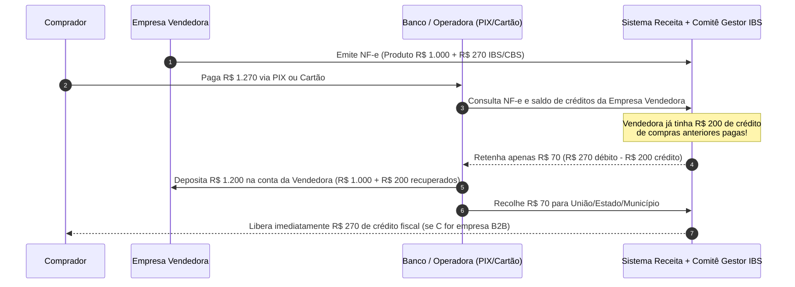

# Etapa 02.2 — Split Payment e Cobrança no Destino

> **Base Legal:** Art. 156-A, § 1º, VII e § 5º, II, "b" da Constituição Federal (EC 132/2023) e arts. 31 a 35 da Lei Complementar nº 214/2025.

Duas inovações tecnológicas e federativas mudam completamente a forma como o dinheiro do imposto circula no Brasil: o **Split Payment** (pagamento dividido) e o **Princípio do Destino**.

---

## 1. O que é o Split Payment (Pagamento Dividido)?

### Como era antes?
Quando você comprava um produto de $\text{R\$ } 100{,}00$ (sendo $\text{R\$ } 80{,}00$ do lojista e $\text{R\$ } 20{,}00$ de imposto) no PIX ou cartão, os **$\text{R\$ } 100{,}00$ iam inteiros para a conta bancária do lojista**. Só no mês seguinte o lojista apurava a guia (DARF/DARE) para repassar o imposto ao governo. Muitos sonegavam ou usavam o dinheiro do imposto como capital de giro e depois atrasavam o pagamento.

### Como funciona o Split Payment na Reforma?
No momento em que o cliente paga via **PIX, Cartão de Crédito/Débito ou Boleto**, a própria instituição financeira ou operadora de pagamento consulta o sistema da Receita Federal / Comitê Gestor do IBS e **separa automaticamente o valor do imposto**:
* A parte da empresa vai para a conta da empresa.
* A parte do imposto (**CBS + IBS**) vai direto para os cofres públicos (ou abate automaticamente os créditos que aquela empresa já tinha acumulados!).

---

## 2. Desenho Visual do Split Payment

```text
+--------------------+
|   COMPRADOR /      |  Paga R$ 1.270,00 via PIX / Cartão / Boleto
|   CLIENTE          |  (R$ 1.000,00 produto + R$ 90,00 CBS + R$ 180,00 IBS)
+--------------------+
          |
          v
+-------------------------------------------------------------------+
|      BANCO / OPERADORA DE CARTÃO / MEIO DE PAGAMENTO (SPLIT)      |
|  Conecta-se à Nota Fiscal Eletrônica (NF-e/NFC-e/NFS-e) em tempo  |
|  real e consulta se o vendedor tem créditos a descontar           |
+-------------------------------------------------------------------+
          |                                           |
          | Parte Líquida                             | Parte do Tributo
          | (R$ 1.000,00 + créditos                   | (CBS + IBS líquidos
          |  que o vendedor já tinha)                 |  devidos na operação)
          v                                           v
+--------------------+                      +-----------------------+
| CONTA BANCÁRIA DA  |                      |   COFRES PÚBLICOS     |
| EMPRESA VENDEDORA  |                      | Receita Federal (CBS) |
|                    |                      | Comitê Gestor (IBS)   |
+--------------------+                      +-----------------------+
```

---

## 3. Fluxograma de Sequência: Como o Split Payment Conversa com os Créditos

Muita gente pergunta: *"Mas se o banco retiver 27% de toda venda minha no Split Payment, e eu já tiver pago imposto quando comprei minha mercadoria, vou ficar sem caixa?"*
**Não!** O sistema do **Split Payment Inteligente** (previsto na LC 214/2025) verifica os créditos que a empresa já tem na conta gráfica antes de reter:



---

## 4. Cobrança no Destino (O Fim da Guerra Fiscal)

No sistema antigo, boa parte do ICMS e quase todo o ISS ficavam na **origem** (onde o vendedor estava).
Com a Reforma Tributária, o **IBS é 100% devido ao Estado e ao Município de DESTINO** (onde o comprador/consumidor recebe o bem ou usufrui do serviço).

### Exemplo Prático com Desenho: Venda Interestadual

Imagine uma fábrica em **São Paulo (SP)** que vende uma geladeira pela internet para um consumidor em **Salvador (BA)**:

```text
+---------------------------+                     +---------------------------+
|   ORIGEM: SÃO PAULO (SP)  |  Envia Geladeira    |  DESTINO: SALVADOR (BA)   |
|   (Onde está a Fábrica/CD)| ==================> |  (Onde está o Consumidor) |
+---------------------------+                     +---------------------------+
  Como era ANTES (ICMS):                            Como fica DEPOIS (IBS):
  Parte do ICMS ficava em SP                        100% do IBS vai para a
  e parte ia para a BA (DIFAL).                     Bahia (Estado) e para
  Havia guerra fiscal para                          Salvador (Município)!
  atrair o Centro de Distribuição.                  Alíquota aplicada é a de
                                                    Salvador/BA.
```

### Onde a Cobrança no Destino se Aplica?
1. **E-commerce e Varejo Interestadual:** Toda venda para consumidor final (ou empresa) aplica a alíquota do município e do estado de destino.
2. **Fim dos Benefícios Fiscais de ICMS (a partir de 2033):** Nenhum estado poderá mais dar "desconto de imposto" para roubar fábricas do estado vizinho, pois a fábrica venderá aplicando a alíquota do estado onde o cliente mora. (Para compensar empresas que tinham incentivos com prazo certo, foi criado o **Fundo de Compensação de Benefícios Fiscais**, com $\text{R\$ } 160\text{ bilhões}$ entre 2025 e 2032, e o **Fundo Nacional de Desenvolvimento Regional - FNDR**).
3. **Escolha logística racional:** As empresas passam a instalar fábricas e centros de distribuição onde faz sentido econômico (perto dos clientes, portos, rodovias e mão de obra), e não por manobra tributária.
