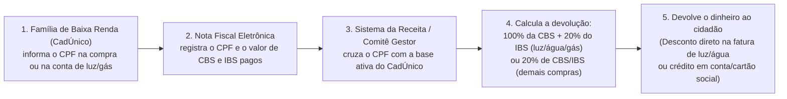

# Etapa 02.3 — Cashback Tributário e Cesta Básica Nacional

> **Base Legal:** Art. 156-A, § 5º, VIII e art. 8º da EC 132/2023; arts. 112 a 125 e Anexo I da Lei Complementar nº 214/2025.

Impostos sobre o consumo costumam pesar proporcionalmente mais no bolso de quem ganha menos (pois famílias de baixa renda gastam quase $100\%$ do salário comprando comida, gás, luz e roupas). Para corrigir isso de forma focalizada, a Reforma Tributária criou dois mecanismos: a **Cesta Básica Nacional de Alimentos (Alíquota Zero)** e o **Cashback de Tributos**.

---

## 1. Cesta Básica Nacional de Alimentos (Alíquota 0%)

A Constituição criou uma **Cesta Básica Nacional** unificada em todo o país, cujos itens têm **alíquota ZERO ($0\%$) de IBS e de CBS**.

### Quais alimentos têm Alíquota Zero (0%)? (Anexo I da LC 214/2025)

```text
+-------------------------------------------------------------------------+
|           CESTA BÁSICA NACIONAL — ALÍQUOTA ZERO (0% IBS e CBS)          |
+-------------------------------------------------------------------------+
|  - Arroz e Feijão                                                       |
|  - Carnes (bovina, suína, ovina, caprina, aves) e Peixes (exceto salmão,|
|    bacalhau, atum e ovas)                                               |
|  - Leite fluido, leite em pó, fórmulas infantis, manteiga e queijos     |
|    (tipo mozarela, minas, prato, coalho, ricota, requeijão)             |
|  - Café, Açúcar, Sal, Farinha de mandioca, trigo e milho                |
|  - Pão comum (pão francês / pão de sal), massas alimentícias e aveia    |
|  - Óleo de soja e óleo de babaçu                                        |
|  - Frutas, verduras, legumes, raízes, tubérculos e ovos                 |
+-------------------------------------------------------------------------+
```

> **Além da Cesta Básica Zero:** A LC 214/2025 também criou uma segunda lista de alimentos de consumo humano com **redução de 60% da alíquota** (como óleos vegetais diversos, crustáceos, sucos naturais sem açúcar adicionado, polpas de frutas, pão de forma, extrato de tomate).

---

## 2. O que é o Cashback do Povo (Devolução de IBS e CBS)?

Em vez de desonerar a conta de energia elétrica ou o botijão de gás para toda a população (o que beneficiaria também mansões e consumidores de alta renda), a Reforma cobra o imposto normalmente na nota e **devolve o imposto diretamente para o CPF das famílias de baixa renda**.

### Quem tem direito ao Cashback (LC 214/2025)?
* Famílias inscritas no **Cadastro Único (CadÚnico)** do Governo Federal;
* Com renda familiar mensal **per capita de até meio salário-mínimo** ($\frac{1}{2}\text{ SM}$ por pessoa da família).

### Tabela Oficial de Percentuais de Devolução (Cashback)

| Tipo de Consumo | % de Devolução da CBS (Federal) | % de Devolução do IBS (Estadual/Municipal)* | Onde se Aplica? |
| :--- | :---: | :---: | :--- |
| **Botijão de Gás (GLP até 13 kg)** | **100%** | **20%** (mínimo) | Compra de gás de cozinha por famílias do CadÚnico |
| **Energia Elétrica, Água, Esgoto e Gás Encanado** | **100%** | **20%** (mínimo) | Contas residenciais de consumo básico (faturas mensais) |
| **Telecomunicações (Internet e Telefonia)** | **100%** | **20%** (mínimo) | Contas de internet/celular de titular do CadÚnico |
| **Demais compras no varejo (Supermercado, roupas, eletrodomésticos)** | **20%** | **20%** (mínimo) | Qualquer compra em que o beneficiário informe o CPF na nota fiscal |

*\*Nota: Estados e Municípios podem aumentar o percentual de devolução do IBS por lei própria acima do piso de 20%.*

---

## 3. Fluxograma: Como o Cashback Funciona na Prática



---

## 4. Exemplo Matemático de Cashback

Imagine que Dona Maria (inscrita no CadÚnico) paga uma **conta de energia elétrica** cujo valor líquido é $\text{R\$ } 100{,}00$, sobre a qual incidem $9\%$ de CBS ($\text{R\$ } 9{,}00$) e $18\%$ de IBS ($\text{R\$ } 18{,}00$), totalizando $\text{R\$ } 127{,}00$:

$$\text{Cashback CBS} = 100\% \times \text{R\$ } 9{,}00 = \text{R\$ } 9{,}00$$
$$\text{Cashback IBS (piso 20\%)} = 20\% \times \text{R\$ } 18{,}00 = \text{R\$ } 3{,}60$$
$$\text{Total Devolvido a Dona Maria} = 9{,}00 + 3{,}60 = \mathbf{\text{R\$ } 12{,}60}$$

* **Quando começa o Cashback?**
  - **2027:** Começa a devolução da **CBS** (federal) em contas de luz, água, esgoto, gás e botijão de 13 kg.
  - **2029:** Começa a devolução do **IBS** (estadual e municipal) e a devolução nas demais compras do varejo com CPF na nota.
