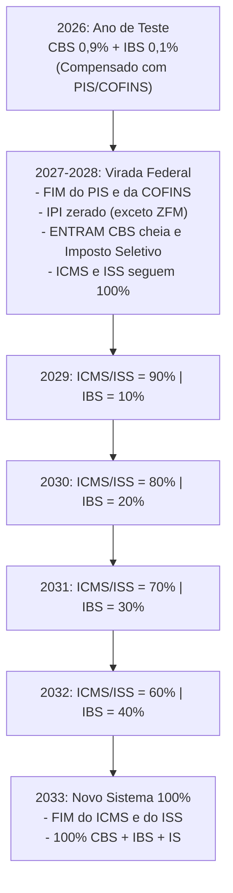

# Etapa 03.1 — Cronograma Completo de Transição (2026 a 2033)

> **Base Legal:** Arts. 124 a 133 do Ato das Disposições Constitucionais Transitórias (ADCT), incluídos pela Emenda Constitucional nº 132/2023, e Livro III da Lei Complementar nº 214/2025.

A Reforma Tributária **não muda tudo da noite para o dia**. Para evitar choques nos preços, permitir a adaptação dos sistemas (ERPs/Notas Fiscais) e calibrar a alíquota exata sem aumentar a carga tributária total do país, foi desenhada uma **transição de 7 anos (2026 a 2032)** para os contribuintes, chegando ao novo modelo $100\%$ implantado em **2033**.

---

## 1. Desenho da Linha do Tempo (2026 a 2033)

```text
  2026          2027          2028          2029          2030          2031          2032          2033
   |             |             |             |             |             |             |             |
   v             v             v             v             v             v             v             v
[TESTE]      [FEDERAL]     [MANTÉM]      [INÍCIO IBS]  [TRANS. 20%]  [TRANS. 30%]  [TRANS. 40%]  [100% NOVO]
CBS 0,9%     Fim do PIS    CBS cheia     ICMS/ISS:90%  ICMS/ISS:80%  ICMS/ISS:70%  ICMS/ISS:60%  Fim total do
IBS 0,1%     e COFINS!     IBS 0,1%      IBS: 10%      IBS: 20%      IBS: 30%      IBS: 40%      ICMS e ISS!
(Abate do    Entra CBS,    ICMS e ISS    da alíquota   da alíquota   da alíquota   da alíquota   Vigência 100%
PIS/COFINS)  IS e IPI=0    100% cheios   definitiva    definitiva    definitiva    definitiva    de CBS+IBS+IS
```

---

## 2. Explicação Ano a Ano (O que acontece em cada etapa?)

### 📅 2026 — O Ano-Teste (Calibragem Nacional)
* **O que entra:** Todas as notas fiscais do regime normal passam a destacar:
  - **CBS de $0{,}9\%$** (Federal)
  - **IBS de $0{,}1\%$** (Estadual/Municipal)
  - Total do teste = **$1{,}0\%$**
* **Há aumento de imposto em 2026? NÃO!**
  - O valor destacado/recolhido de $1\%$ (ou dispensado de recolhimento para quem cumprir as obrigações acessórias de emissão das novas notas fiscais conforme a LC 214/2025) é **compensado integralmente** com o valor devido de **PIS e COFINS** (ou outros tributos federais).
  - **Objetivo:** Testar os novos layouts de NF-e, NFC-e, NFS-e, CT-e e medir a base real de arrecadação do país para calcular a alíquota definitiva da CBS de 2027.

---

### 📅 2027 e 2028 — Virada Federal (Entram CBS e Imposto Seletivo; Saem PIS e COFINS)
* **Extintos definitivamente:** **PIS** e **COFINS** deixam de existir.
* **Entra em vigor integralmente:** A **CBS** (alíquota federal cheia).
* **Entra em vigor:** O **Imposto Seletivo (IS)** sobre cigarros, bebidas alcoólicas, bebidas açucaradas, veículos poluentes, mineração e apostas.
* **IPI:** Alíquota cai para **$0\%$** em todo o Brasil (exceto para produtos que concorram com os fabricados na Zona Franca de Manaus).
* **Cashback Federal:** Começa o cashback da CBS para famílias de baixa renda (CadÚnico).
* **E o IBS?** Em 2027 e 2028, o IBS continua na alíquota simbólica de **$0{,}1\%$** ($0{,}05\%$ estadual + $0{,}05\%$ municipal), enquanto a CBS tem um desconto de $0{,}1\%$ para não aumentar a carga. O **ICMS** e o **ISS** continuam valendo $100\%$ normalmente em 2027 e 2028.

---

### 📅 2029 a 2032 — Escadinha de Transição Estadual e Municipal (Sai ICMS/ISS $\rightarrow$ Entra IBS)
Durante esses 4 anos, o **ICMS** e o **ISS** vão encolhendo $10\%$ ao ano, enquanto o **IBS** cresce na mesma proporção:

| Ano | Quanto ainda vale do ICMS e do ISS antigo? | Quanto já vale do novo IBS? | Como funciona para as empresas? |
| :---: | :---: | :---: | :--- |
| **2029** | **90%** das alíquotas atuais | **10%** da alíquota cheia do IBS | Convivência dos dois sistemas (dupla apuração na NF). |
| **2030** | **80%** das alíquotas atuais | **20%** da alíquota cheia do IBS | Créditos de ICMS continuam sendo usados na parcela de $80\%$. |
| **2031** | **70%** das alíquotas atuais | **30%** da alíquota cheia do IBS | Benefícios fiscais de ICMS continuam sendo compensados pelo Fundo Federal. |
| **2032** | **60%** das alíquotas atuais | **40%** da alíquota cheia do IBS | Último ano de existência do ICMS e do ISS no Brasil. |

---

### 📅 2033 — Vigência 100% do Novo Sistema Tributário
* **Extintos definitivamente:** **ICMS** e **ISS** deixam de existir em 1º de janeiro de 2033.
* **Vigência plena:** O Brasil passa a operar exclusivamente com o **IVA Dual (CBS + IBS)** e o **Imposto Seletivo (IS)** sobre o consumo.
* **E os saldos credores acumulados de ICMS até 31/12/2032?**
  - Não são perdidos! Após homologação pelo Estado, os créditos acumulados de ICMS poderão ser compensados com o **IBS** em **240 parcelas mensais iguais** (20 anos, corrigidos pelo IPCA), ou em prazo menor para créditos de Ativo Imobilizado, podendo inclusive ser transferidos a terceiros.

---

## 3. Fluxograma da Transição dos Tributos (2026–2033)



---

## 4. E a Transição entre os Estados e Municípios (2029 a 2078)?
Além da transição para os **contribuintes** (que termina em **2033**), existe uma transição interna **apenas entre os governos estaduais e municipais** que dura 50 anos (**2029 a 2078**).
* **Você não precisa se preocupar com ela no cálculo da nota:** Para a empresa e o cidadão, a cobrança no destino já estará 100% implantada em 2033. A transição de 50 anos é apenas a regra que o Comitê Gestor do IBS usará nos bastidores para dividir o bolo arrecadado entre os estados que perderiam receita com o fim da cobrança na origem.
