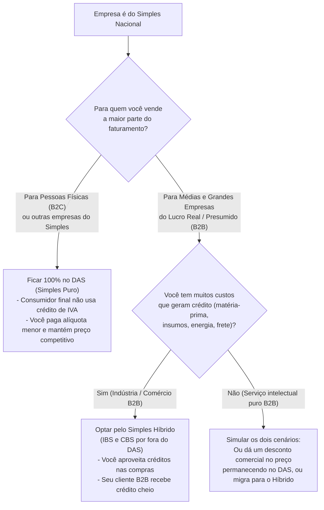

# Etapa 04.1 — Onde se Aplica: Simples Nacional e MEI

> **Base Legal:** Art. 146, III, "d" e art. 156-A, § 1º, IX, "b" da Constituição Federal (EC 132/2023) e arts. 41, § 3º e 55 da Lei Complementar nº 214/2025.

Mais de $70\%$ das empresas brasileiras estão no **Simples Nacional** ou são **MEI (Microempreendedor Individual)**. Uma das maiores dúvidas é: *"O Simples Nacional vai acabar?"*
**Resposta direta: NÃO!** O Simples Nacional e o MEI foram expressamente preservados na Constituição, mas ganham uma **nova escolha estratégica (regime híbrido)**.

---

## 1. Como funciona a Nova Escolha do Simples Nacional?

Com a Reforma Tributária, a empresa optante pelo Simples Nacional continuará recolhendo seus outros tributos (IRPJ, CSLL, CPP/INSS) na guia única (**DAS**), mas, para o **IBS e a CBS**, poderá escolher entre **duas opções**:

```text
+-----------------------------------------------------------------------------+
|                 AS DUAS OPÇÕES DA EMPRESA DO SIMPLES NACIONAL               |
+-----------------------------------------------------------------------------+
|                                                                             |
|  OPÇÃO A: Continuar 100% dentro do DAS (Simples Puro)                       |
|  -------------------------------------------------------------------------  |
|  - Paga uma alíquota reduzida de IBS e CBS dentro do DAS mensal.            |
|  - NÃO toma créditos de IBS/CBS nas suas compras.                           |
|  - Transfere ao seu cliente (PJ) apenas o crédito equivalente ao pequeno    |
|    percentual de IBS/CBS que pagou dentro do DAS.                           |
|  -> IDEAL PARA: Quem vende para Consumidor Final (B2C) — padarias, salões,  |
|     lojas de bairro, restaurantes, clínicas, comércio varejista.            |
|                                                                             |
|  OPÇÃO B: Pagar IBS e CBS "Por Fora" do DAS (Simples Híbrido)               |
|  -------------------------------------------------------------------------  |
|  - Continua no Simples para IRPJ, CSLL e INSS Patronal (CPP).               |
|  - Apura o IBS e a CBS pelo Regime Regular (alíquota cheia, mas tomando     |
|    100% dos créditos das suas compras!).                                    |
|  - Transfere 100% de crédito cheio (ex.: ~27%) para seus clientes empresas. |
|  -> IDEAL PARA: Quem vende para outras Empresas (B2B) — pequenas indústrias,|
|     fornecedores corporativos, atacadistas que vendem para grandes redes.   |
|                                                                             |
+-----------------------------------------------------------------------------+
```

---

## 2. Por que essa escolha existe? (O Efeito B2B vs. B2C)

Vamos comparar com um exemplo numérico por que o **cliente** da sua empresa influencia a sua escolha no Simples Nacional:

### Exemplo: Pequena Fábrica de Embalagens (Simples Nacional) vendendo para uma Grande Indústria

Suponha que a Pequena Fábrica venda $\text{R\$ } 10.000{,}00$ em caixas de papelão para uma Grande Indústria:

| Critério | Opção A: IBS/CBS dentro do DAS | Opção B: IBS/CBS por fora (Híbrido) |
| :--- | :--- | :--- |
| **Quanto a Pequena Fábrica cobra na NF?** | $\text{R\$ } 10.000{,}00$ (embutindo $\sim\text{R\$ } 350{,}00$ de IBS/CBS do DAS) | $\text{R\$ } 10.000{,}00 + \text{R\$ } 2.700{,}00\text{ (27\% IVA)} = \text{R\$ } 12.700{,}00$ |
| **Quanto de crédito a Grande Indústria recebe para descontar?** | Apenas **$\text{R\$ } 350{,}00$** (o que foi pago no DAS) | **$\text{R\$ } 2.700{,}00$** (crédito integral de $27\%$) |
| **Custo líquido real da compra para a Grande Indústria:** | $10.000 - 350 = \mathbf{\text{R\$ } 9.650{,}00}$ | $12.700 - 2.700 = \mathbf{\text{R\$ } 10.000{,}00}$ (mas a pequena fábrica descontou os créditos do papel que comprou, podendo baixar seu preço base para $\text{R\$ } 9.200{,}00$!) |

---

## 3. Fluxograma de Decisão para Empresas do Simples Nacional



---

## 4. Como fica o MEI (Microempreendedor Individual) e o Nanoempreendedor?

1. **MEI (Microempreendedor Individual):**
   - Continua pagando um valor fixo mensal muito baixo no DAS-MEI.
   - Os valores fixos de ICMS ($\text{R\$ } 1{,}00$) e ISS ($\text{R\$ } 5{,}00$) dentro do boleto do MEI serão substituídos por valores fixos simbólicos de **IBS e CBS** na transição.
   - Está dispensado da complexidade do regime regular.
2. **Nova Figura — O "Nanoempreendedor" (Pessoa Física isenta de IBS/CBS):**
   - A Lei Complementar nº 214/2025 (art. 26, IV) criou o conceito de **Nanoempreendedor**: a pessoa física com receita bruta anual de até **$50\%$ do limite do MEI** ($\text{R\$ } 40.500{,}00/\text{ano}$, considerando o teto de $\text{R\$ } 81.000{,}00$) que não tenha aberto CNPJ como MEI **não é contribuinte do IBS nem da CBS**!
   - **Exemplos onde se aplica:** Motoristas de aplicativo de tempo parcial, revendedoras autônomas de cosméticos, artesãos e trabalhadores informais de baixa receita.
   - *Regra especial para motoristas e entregadores de aplicativo (Pessoa Física):* Só é considerado contribuinte se $25\%$ da sua receita bruta anual ultrapassar o limite de $\text{R\$ } 40.500{,}00$ (o que permite faturar até $\text{R\$ } 162.000{,}00/\text{ano}$ como pessoa física sem ser contribuinte de IBS/CBS!).
