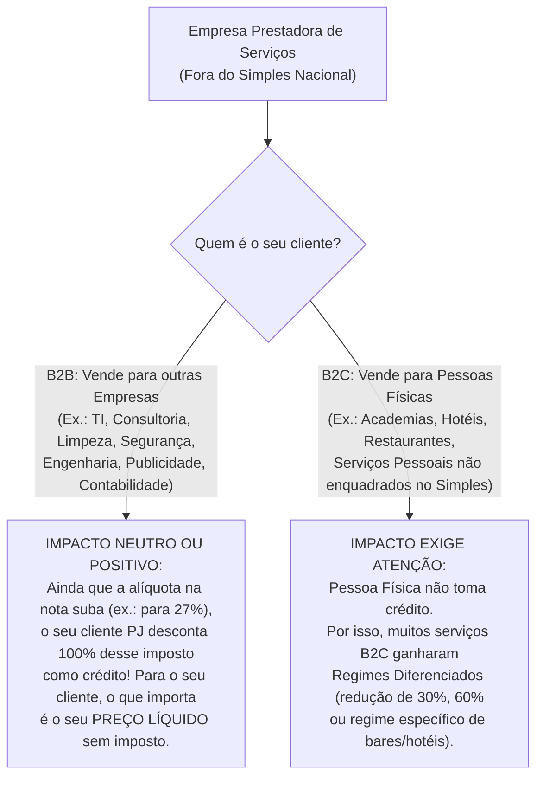

# Etapa 04.2 — Onde se Aplica: Indústria, Comércio, Serviços e Profissionais Liberais

> **Base Legal:** Lei Complementar nº 214/2025 (Regime Geral, Não Cumulatividade e Redução de 30% para Profissionais Liberais Regulamentados - art. 127).

A Reforma Tributária unifica a tributação de bens e serviços, mas o impacto prático varia bastante conforme a estrutura de custos de cada setor (**Indústria**, **Comércio** ou **Serviços**).

---

## 1. Visão Comparativa por Setor Econômico

```text
+-------------------+----------------------------+----------------------------+
|      SETOR        |     COMO ERA ANTES         |     COMO FICA DEPOIS       |
+-------------------+----------------------------+----------------------------+
| 1. INDÚSTRIA      | Muito onerada: IPI + ICMS  | Grande beneficiada:        |
|                   | + PIS/COFINS, créditos     | - Fim do IPI (alíquota 0%) |
|                   | restritos (só insumo       | - Crédito imediato na      |
|                   | físico) e créditos de      |   compra de máquinas       |
|                   | exportação travados.       | - Crédito sobre fretes, TI,|
|                   |                            |   energia e serviços.      |
+-------------------+----------------------------+----------------------------+
| 2. COMÉRCIO       | Sofria com a Substituição  | Fim da Substituição        |
|    (Atacado e     | Tributária (ICMS-ST pago   | Tributária (ICMS-ST)!      |
|     Varejo)       | antecipado sem ter vendido)| Crédito amplo sobre aluguel|
|                   | e milhares de regras de    | da loja, energia, maquini- |
|                   | MVA e NCM por estado.      | nha, marketing e frete.    |
+-------------------+----------------------------+----------------------------+
| 3. SERVIÇOS       | Pagava ISS (2% a 5%) +     | Passa para a alíquota do   |
|    (Geral)        | PIS/COFINS (3,65% no       | IVA Dual (CBS + IBS).      |
|                   | Lucro Presumido ou 9,25%   | - Quem vende para empresas |
|                   | no Lucro Real).            |   (B2B) repassa o crédito! |
|                   | Não gerava crédito de ISS. | - Quem tem folha alta e    |
|                   |                            |   vende para PF sente mais.|
+-------------------+----------------------------+----------------------------+
```

---

## 2. Aplicação Prática em Cada Setor

### A) Na Indústria (Manufatura e Exportação)
* **Onde se aplica:** Fábricas de máquinas, alimentos, têxtil, química, metalurgia, móveis, etc.
* **Principais ganhos:**
  1. **Crédito de Bens de Capital (Ativo Imobilizado):** No modelo antigo, quando uma fábrica comprava uma máquina nova, demorava **48 meses (4 anos)** para recuperar o ICMS (CIAP). Na Reforma, o crédito de IBS e CBS na compra de máquinas e equipamentos é **integral e imediato**!
  2. **Exportações 100% Desoneradas:** Exportar não paga IBS, CBS nem Imposto Seletivo, e o exportador mantém $100\%$ dos créditos das compras, com prazo legal de ressarcimento rápido (até 60 dias na regra geral, ou 30 dias para contribuintes em programas de conformidade).

---

### B) No Comércio (Varejo Físico e E-commerce)
* **Onde se aplica:** Supermercados, lojas de roupas, materiais de construção, marketplaces, distribuidoras.
* **Principais mudanças:**
  1. **Fim do ICMS-ST (Substituição Tributária):** O varejista não precisa mais adiantar o imposto de uma mercadoria que ainda está parada na prateleira. O imposto só é pago quando a venda realmente acontece.
  2. **Aluguel, Energia e Frete dão crédito:** Uma loja de shopping que paga $\text{R\$ } 30.000{,}00$ de aluguel e $\text{R\$ } 5.000{,}00$ de conta de luz poderá descontar o IBS e a CBS embutidos no aluguel e na energia!

---

### C) No Setor de Serviços (O Divisor de Águas: B2B vs. B2C)
O setor de serviços é onde a análise precisa ser mais cuidadosa, porque o maior custo de uma empresa de serviços costuma ser a **folha de pagamento (salários CLT)**, e salários não pagam IVA (logo, não geram crédito de IBS/CBS).

Veja a diferença entre uma empresa de serviços **B2B** (que atende outras empresas) e uma **B2C** (que atende pessoas físicas):



---

## 3. Profissionais Liberais Regulamentados (Redução de 30% na Alíquota!)

A Lei Complementar nº 214/2025 (art. 127) concedeu uma **redução de 30% nas alíquotas de IBS e CBS** para sociedades de profissionais que prestam serviços intelectuais de natureza científica, literária ou artística, submetidos à fiscalização de **Conselho Profissional**.

* **Cálculo da Alíquota com Redução de 30%:**
  $$\text{Alíquota Aplicada} = \text{Alíquota Padrão} \times (1 - 0{,}30) = 70\% \text{ da Alíquota Padrão}$$
  *(Ex.: Se a alíquota padrão for $27\%$, a alíquota reduzida será $27\% \times 0{,}70 = \mathbf{18{,}9\%}$, com direito a créditos nas compras!)*

### Quais das 18 profissões regulamentadas entram nessa redução de 30%?
1. Administradores
2. Advogados
3. Arquitetos e Urbanistas
4. Assistentes Sociais
5. Bibliotecários
6. Biólogos
7. Contabilistas (Contadores)
8. Economistas
9. Economistas Domésticos
10. Profissionais de Educação Física
11. Engenheiros e Agrônomos
12. Estatísticos
13. Médicos Veterinários e Zootecnistas
14. Museólogos
15. Químicos
16. Profissionais de Relações Públicas
17. Técnicos Industriais
18. Técnicos Agrícolas

*(Nota: Para ter direito à redução de $30\%$, a sociedade deve ser composta apenas por profissionais habilitados da mesma área de atuação, sem sócio pessoa jurídica e exercendo a atividade submetida ao respectivo conselho).*
