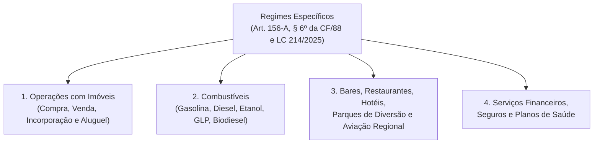

# Etapa 04.3 — Onde se Aplica: Regimes Diferenciados (Descontos de 60% e 100%) e Regimes Específicos

> **Base Legal:** Art. 9º da EC 132/2023 e Livros I (Título III e IV) da Lei Complementar nº 214/2025.

Nem tudo na economia pode pagar a alíquota padrão cheia do IVA Dual. Setores essenciais para a população (como **Saúde, Educação, Transporte Público e Alimentos**) ou setores com dinâmica econômica própria (como **Imóveis, Combustíveis e Bancos**) possuem regras próprias na Reforma Tributária.

Eles se dividem em dois grupos:
1. **Regimes Diferenciados:** Funcionam com a mesma regra do IVA Dual, mas com **desconto de $60\%$ ou $100\%$ (Alíquota Zero)** na alíquota padrão.
2. **Regimes Específicos:** Têm uma forma diferente de calcular a base ou a alíquota (ex.: sobre a margem, por litro/m³ ou com redutor social).

---

## 1. Mapa Visual dos Descontos de Alíquota (100%, 60% e 30%)

Supondo uma alíquota padrão ilustrativa de **$27\%$**:

```text
+-----------------------------------------------------------------------------+
|  FAIXA 1: ALÍQUOTA ZERO — REDUÇÃO DE 100% (Paga 0% de IBS e CBS)            |
+-----------------------------------------------------------------------------+
|  - Cesta Básica Nacional de Alimentos (Arroz, feijão, carnes, leite, pão...) |
|  - Medicamentos para doenças graves (câncer, HIV, doenças raras) e vacinas  |
|  - Produtos de cuidados básicos à saúde menstrual (absorventes, coletores)  |
|  - Dispositivos de acessibilidade para Pessoas com Deficiência (PcD)        |
|  - Hortícolas, frutas e ovos                                                |
|  - Transporte público coletivo rodoviário e metroviário urbano/metropolitano|
|  - Educação Superior pelo PROUNI (parcela das bolsas)                       |
|  - Automóveis adquiridos por taxistas e PcD (com limites legais)            |
+-----------------------------------------------------------------------------+

+-----------------------------------------------------------------------------+
|  FAIXA 2: REDUÇÃO DE 60% (Paga apenas 40% da alíquota padrão -> ~10,8%)     |
+-----------------------------------------------------------------------------+
|  - Serviços de Educação (Escolas infantis, fundamental, médio, faculdades,  |
|    cursos técnicos)                                                         |
|  - Serviços de Saúde Humana (Hospitais, clínicas médicas, odontológicas,    |
|    exames laboratoriais, fisioterapia, psicologia, fonoaudiologia, nutrição)|
|  - Medicamentos registrados na ANVISA e Dispositivos Médicos                |
|  - Alimentos destinados ao consumo humano (lista complementar à Cesta Zero) |
|  - Produtos de higiene pessoal e limpeza consumidos por famílias de baixa   |
|    renda (sabonete, creme dental, papel higiênico, água sanitária, sabão)   |
|  - Produtos agropecuários, aquícolas, pesqueiros, florestais e insumos agro |
|  - Produções artísticas, culturais, eventos, jornalísticas e desportivas    |
|  - Bens e serviços ligados à Soberania e Segurança Nacional / Cibernética   |
+-----------------------------------------------------------------------------+

+-----------------------------------------------------------------------------+
|  FAIXA 3: REDUÇÃO DE 30% (Paga 70% da alíquota padrão -> ~18,9%)            |
+-----------------------------------------------------------------------------+
|  - 18 Profissões Intelectuais Regulamentadas (Advogados, Engenheiros,       |
|    Arquitetos, Contadores, Administradores, Economistas, Veterinários, etc.)|
+-----------------------------------------------------------------------------+
```

---

## 2. Como Fica o Agronegócio?

O Agronegócio tem dois pilares muito importantes na Reforma Tributária (LC 214/2025):

1. **Insumos e Produtos Agropecuários com Redução de 60%:** Sementes, fertilizantes, defensivos, rações e produtos agrícolas in natura têm redução de $60\%$ na alíquota (ou diferimento nas vendas entre produtores/agroindústrias para não travar o fluxo de caixa).
2. **Produtor Rural Integrado ou com Faturamento até R$ 3,6 milhões/ano:**
   - O produtor rural (Pessoa Física ou Jurídica) com receita bruta anual inferior a **$\text{R\$ } 3.600.000{,}00$** **NÃO é obrigado a ser contribuinte do IBS e da CBS**!
   - Ele não precisa cobrar IBS/CBS nas suas vendas. E, para que o frigorífico, laticínio ou cooperativa não deixe de comprar dele, a lei concede um **crédito presumido** para a agroindústria que compra desse pequeno/médio produtor rural!

---

## 3. Regimes Específicos (Regras Próprias de Cálculo)



### A) Operações com Imóveis (Venda, Construção e Aluguel) — Muito Importante!
As operações imobiliárias (realizadas por empresas ou por pessoas físicas que tenham muitos imóveis alugados/vendidos) ganharam:
* **Redução na Alíquota:**
  - **Venda, incorporação, loteamento e construção civil:** Redução de **$50\%$** na alíquota padrão do IBS e da CBS.
  - **Locação (Aluguel), cessão e arrendamento de imóveis:** Redução de **$70\%$** na alíquota padrão (paga apenas $30\%$ da alíquota padrão!).
* **Redutores de Base de Cálculo para proteger a moradia:**
  - **Redutor de Ajuste:** Na venda de um imóvel, desconta-se da base de cálculo o custo de aquisição do terreno/imóvel atualizado pelo IPCA (cobra-se apenas sobre o valor agregado real).
  - **Redutor Social na Compra da Casa Própria:** Na venda de imóvel residencial novo, abate-se **$\text{R\$ } 100.000{,}00$** da base de cálculo (e **$\text{R\$ } 30.000{,}00$** no caso de lotes residenciais) antes de calcular o imposto!
  - **Redutor Social no Aluguel Residencial:** Desconta-se **$\text{R\$ } 600{,}00$ por mês** da base de cálculo de cada aluguel residencial! *(Se o aluguel residencial for de $\text{R\$ } 2.000{,}00$, o imposto incide apenas sobre $\text{R\$ } 1.400{,}00$)*.
* **Quando uma Pessoa Física (CPF) que aluga imóveis entra no IBS/CBS?**
  - **Regra Geral:** Pessoas físicas que têm 1, 2 ou 3 imóveis alugados **NÃO** pagam IBS nem CBS!
  - Só passa a ser contribuinte de IBS/CBS na locação a Pessoa Física que cumprir **os dois requisitos ao mesmo tempo** no ano anterior:
    1. Possuir **mais de 3 imóveis distintos** alugados; **E**
    2. Receber receita total de aluguéis **acima de $\text{R\$ } 240.000{,}00/\text{ano}$** ($\text{R\$ } 20.000{,}00/\text{mês}$ de média), atualizado pelo IPCA (ou ultrapassar em $20\%$ esse valor no próprio ano, isto é, $\text{R\$ } 288.000{,}00$).

### B) Combustíveis (Cobrança Monofásica por Litro / kg)
* Gasolina, etanol, diesel, biodiesel e gás de cozinha (GLP) têm tributação **monofásica** (cobrada uma única vez na refinaria/usina/importador) e com **alíquota uniforme em reais ($\text{R\$}$) por litro ou quilo** em todo o território nacional (acabam as alíquotas diferentes entre estados).
* Empresas que usam combustível como insumo (ex.: transportadoras de carga) têm direito a tomar o crédito do IBS/CBS monofásico pago no diesel!

### C) Bares, Restaurantes, Hotéis e Parques Temáticos
* Como vendem quase $100\%$ para pessoas físicas e têm alta mão de obra, contam com **redução de 40% na alíquota** (pagam $60\%$ da alíquota padrão), mas sem gerar crédito para quem consome no restaurante/hotel (exceto regras específicas para eventos corporativos/agências).

### D) Planos de Saúde
* Planos de assistência à saúde têm **redução de 60% na alíquota**, incidindo sobre a receita líquida (mensalidades recebidas menos as indenizações/custos médico-hospitalares pagos aos prestadores da rede), evitando a dupla tributação entre o plano e o hospital.
