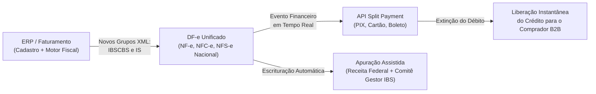

# Etapa 06.1 — Impacto em Sistemas (ERP / NF-e) e Qualidade de Software (QA Fiscal)

> **Normas e Fontes Técnicas de Referência:**
> - **Legislação Fiscal:** Emenda Constitucional nº 132/2023, Lei Complementar nº 214/2025 e Notas Técnicas conjuntas ENCAT/RFB para documentos fiscais eletrônicos (NF-e, NFC-e, NFS-e Padrão Nacional, CT-e).
> - **Modelos de Qualidade de Produto:** **ISO/IEC 25010:2023** (*Systems and software Quality Requirements and Evaluation - SQuaRE*, revisão 2023 com 9 características de qualidade).
> - **Engenharia e Técnicas de Teste:** **ISTQB CTFL v4.0 (2023)** e **ISO/IEC/IEEE 29119-3** (Documentação de Teste).

A Reforma Tributária é também a **maior reforma de sistemas de software empresarial (ERP, PDV, E-commerce, Faturamento e Meios de Pagamento)** desde a criação da Nota Fiscal Eletrônica em 2006.

---

## 1. O Que Muda nos Sistemas e na Nota Fiscal Eletrônica (A partir de 2026)

### Principais Mudanças Técnicas nos Documentos Fiscais (Notas Técnicas RFB/ENCAT):
1. **Unificação da NFS-e (Nota Fiscal de Serviços Eletrônica):** Todos os mais de 5.570 municípios passam a integrar o **Padrão Nacional da NFS-e**, permitindo a apuração centralizada do IBS e da CBS.
2. **Novos Grupos XML (`<IBSCBS>` e `<IS>`):**
   - Inclusão do **CST (Código de Situação Tributária)** unificado para IBS/CBS e do código de classificação tributária (`cClassTrib`) vinculado à Lei Complementar nº 214/2025.
   - Campos separados para: Alíquota da CBS (`pCBS`), Alíquota do IBS Estadual (`pIBSUF`), Alíquota do IBS Municipal (`pIBSMun`), Percentual de Redução de Alíquota (`pRedAliq`), Redutor Social e Crédito Presumido.
3. **Convivência Dupla (2026 a 2032):** Durante 7 anos, o motor fiscal do software precisará calcular **simultaneamente** os tributos antigos (ICMS, ISS, PIS, COFINS, IPI) e os novos (CBS, IBS, IS).

---

## 2. Requisitos de Qualidade do Motor Fiscal segundo a ISO/IEC 25010:2023

Na versão revisada da norma **ISO/IEC 25010:2023** (que passou a ter **9 características**, com a inclusão de *Safety* e a renomeação de *Usability* $\rightarrow$ *Interaction capability* e *Portability* $\rightarrow$ *Flexibility*), a arquitetura de um motor de cálculo da Reforma Tributária deve priorizar:

| Característica (ISO/IEC 25010:2023) | Subcaracterística Crítica | Aplicação no Software da Reforma Tributária |
| :--- | :--- | :--- |
| **1. Adequação Funcional** (*Functional Suitability*) | **Corretude Funcional** (*Functional Correctness*) | Exatidão matemática de arredondamento (2 casas decimais no valor do tributo, cálculo "por fora" e aplicação exata dos redutores de $30\%$, $60\%$, $70\%$ e $100\%$). |
| **2. Compatibilidade** (*Compatibility*) | **Interoperabilidade** (*Interoperability*) | Integração síncrona/assíncrona entre o emissor de NF-e, os provedores de pagamento (Split Payment via PIX/Cartão) e a Apuração Assistida da RFB/Comitê Gestor. |
| **3. Confiabilidade** (*Reliability*) | **Tolerância a Falhas** (*Fault Tolerance*) | Contingência offline na emissão de NFC-e/NF-e e reconciliação automática caso o serviço do Split Payment ou da SEFAZ/Comitê Gestor sofra instabilidade. |
| **4. Manutenibilidade** (*Maintainability*) | **Modificabilidade** (*Modifiability*) | Parametrização das alíquotas anuais de transição (2026 a 2033) em tabelas de vigência por data, sem necessidade de *hardcoding* no código-fonte. |
| **5. Flexibilidade** (*Flexibility* — antiga *Portability*) | **Adaptabilidade** (*Adaptability*) | Adaptação dinâmica à alíquota de destino (qualquer um dos 27 Estados + 5.570 Municípios do comprador). |

---

## 3. Engenharia de Testes Fiscais (ISTQB CTFL v4.0)

Para garantir a ausência de defeitos de cálculo nos motores fiscais, aplicamos duas técnicas de **caixa-preta** do **ISTQB CTFL v4.0 (2023)**: **Tabela de Decisão** e **Análise de Valor-Limite (AVL)**.

### A) Tabela de Decisão — Enquadramento de Locador Pessoa Física (LC 214/2025, art. 251)

* **Requisito Legal:** A Pessoa Física que aluga imóveis só é contribuinte de IBS/CBS se:
  - **Condição C1:** Possuiu **mais de 3 imóveis distintos** alugados no ano anterior ($Q > 3$);
  - **Condição C2:** Teve receita bruta de aluguéis **acima de R$ 240.000,00** no ano anterior ($R > 240.000$);
  - **Condição C3:** Teve receita bruta de aluguéis no ano corrente **acima de R$ 288.000,00** ($R_{\text{atual}} > 288.000$, correspondente a $120\%$ do limite).

| Condições / Ações | Regra 1 | Regra 2 | Regra 3 | Regra 4 | Regra 5 |
| :--- | :---: | :---: | :---: | :---: | :---: |
| **C1:** Mais de 3 imóveis ($Q > 3$)? | F | V | F | V | F ou V |
| **C2:** Receita ano anterior $> \text{R\$ } 240.000$? | F | F | V | V | F ou V |
| **C3:** Receita ano corrente $> \text{R\$ } 288.000$? | F | F | F | F | **V** |
| **Ação A1: É Contribuinte de IBS/CBS?** | **NÃO** | **NÃO** | **NÃO** | **SIM** | **SIM** |

---

### B) Análise de Valor-Limite (AVL de 3 Valores) — Limites Legais de Enquadramento

Aplicando a técnica de **Análise de Valor-Limite (ISTQB CTFL 4.0, Seção 4.2.2)** nas fronteiras numéricas da regra:

1. **Fronteira 1 — Quantidade de Imóveis ($Q$, passo $= 1$, limite $Q \le 3$ não contribuinte vs. $Q \ge 4$ contribuinte se $R > 240.000$):**
   - Valores de teste: $Q \in \{2, 3, 4\}$
   - Para $Q = 3$ e $R = 250.000{,}00 \Rightarrow$ **Resultado Esperado:** `False` (Não Contribuinte).
   - Para $Q = 4$ e $R = 250.000{,}00 \Rightarrow$ **Resultado Esperado:** `True` (Contribuinte).
2. **Fronteira 2 — Receita Anual Anterior ($R$, passo $= \text{R\$ } 0{,}01$, limite $\text{R\$ } 240.000{,}00$ com $Q = 4$):**
   - Valores de teste: $\text{R\$ } 239.999{,}99$, $\text{R\$ } 240.000{,}00$, $\text{R\$ } 240.000{,}01$
   - Para $R = 240.000{,}00 \Rightarrow$ **Resultado Esperado:** `False` (A lei exige receita *superior* a $\text{R\$ } 240.000{,}00$).
   - Para $R = 240.000{,}01 \Rightarrow$ **Resultado Esperado:** `True` (Contribuinte).
3. **Fronteira 3 — Redutor Social Mensal de Locação Residencial (Limite $\text{R\$ } 600{,}00$):**
   - Valores de teste de aluguel: $\text{R\$ } 599{,}99$, $\text{R\$ } 600{,}00$, $\text{R\$ } 600{,}01$
   - Para aluguel $\le \text{R\$ } 600{,}00 \Rightarrow$ Base de cálculo $= \text{R\$ } 0{,}00 \Rightarrow$ Tributo $= \text{R\$ } 0{,}00$ (nunca pode gerar base ou imposto negativo!).

---

## 4. Casos de Teste Estruturados (ISO/IEC/IEEE 29119-3)

| ID do Caso | Título | Pré-Condição / Dados de Entrada | Resultado Esperado | Técnica ISTQB |
| :--- | :--- | :--- | :--- | :--- |
| **CT-RT-01** | Cálculo de IVA Dual com Redução de 60% (Saúde/Educação) | `valor_liquido = 1000.00`, `cbs = 0.088`, `ibs = 0.177`, `reducao = 0.60` | Alíquota efetiva $= 10{,}60\%$; Tributo $= \text{R\$ } 106{,}00$ | Partição de Equivalência |
| **CT-RT-02** | Alíquota Zero da Cesta Básica (Redução de 100%) | `valor_liquido = 500.00`, `reducao = 1.00` | Alíquota efetiva $= 0{,}00\%$; Tributo $= \text{R\$ } 0{,}00$ | Partição de Equivalência |
| **CT-RT-03** | Aluguel Residencial igual ao Redutor Social (R$ 600,00) | `valor_aluguel = 600.00`, `redutor_social = 600.00` | `base_calculo = 0.00`, `tributo_devido = 0.00` | Análise de Valor-Limite |
| **CT-RT-04** | Fronteira de Receita de Locador PF em R$ 240.000,00 vs R$ 240.000,01 | `qtd_imoveis = 4`, `receita = 240000.00` e `240000.01` | `240000.00` $\rightarrow$ `False`; `240000.01` $\rightarrow$ `True` | Análise de Valor-Limite + Tabela de Decisão |
| **CT-RT-05** | Bloqueio de Crédito para Bens de Uso e Consumo Pessoal | Compra de $\text{R\$ } 2.000{,}00$ com `gera_credito = False` | Valor do imposto pago na entrada não é somado ao `total_creditos` da apuração | Regra de Negócio / Partição de Equivalência |
