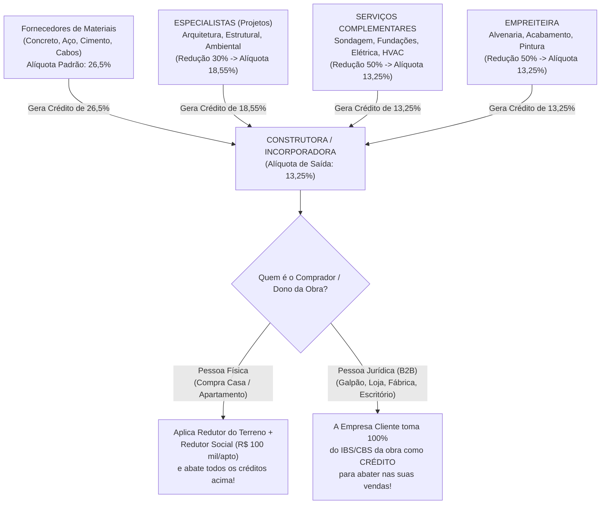

# Etapa 07.1 — Guia Setorial da Construção Civil na Reforma Tributária

> **Base Legal:** Art. 156-A, § 6º, II da Constituição Federal (EC 132/2023) e **Arts. 251 a 269 (Regime Específico de Bens Imóveis)** + **Art. 127 (Profissões Intelectuais Regulamentadas)** da **Lei Complementar nº 214/2025**.

O setor de **Construção Civil e Mercado Imobiliário** envolve vários atores trabalhando juntos na mesma obra. Com a Reforma Tributária, **cada perfil de empresa da cadeia possui um enquadramento específico** de alíquota, base de cálculo e geração de créditos.

---

## 1. Mapa Visual dos 5 Perfis da Construção Civil

*(Considerando a alíquota padrão de referência do IVA Dual estimada em **$26{,}5\%$** = $8{,}8\%$ CBS + $17{,}7\%$ IBS)*

```text
+---------------------------------------------------------------------------------+
|            COMO CADA EMPRESA DA CONSTRUÇÃO CIVIL É TRIBUTADA (LC 214/2025)      |
+---------------------------------------------------------------------------------+
|                                                                                 |
| 1. INCORPORADORA (Venda de unidades imobiliárias na planta ou prontas)          |
|    - Redução de Alíquota: 50% -> Alíquota de 13,25% (CBS 4,4% + IBS 8,85%)      |
|    - Base de Cálculo: Receita de Venda (-) Redutor de Ajuste (Terreno/ITBI)     |
|                       (-) Redutor Social (R$ 100 mil/apto ou R$ 30 mil/lote)    |
|    - Créditos: Desconta créditos de materiais, projetos, empreiteiras e Mkt!    |
|                                                                                 |
| 2. CONSTRUTORA (Empreitada Global - Obra com materiais + mão de obra)           |
|    - Redução de Alíquota: 50% -> Alíquota de 13,25% sobre o serviço/obra        |
|    - Base de Cálculo: Valor total do contrato de construção                     |
|    - Créditos: Desconta 100% do IBS/CBS pago nos materiais (cimento, aço, etc.),|
|      máquinas, subempreiteiras e especialistas contratados.                     |
|                                                                                 |
| 3. EMPREITEIRA (Subempreitada de mão de obra ou execução parcial na obra)       |
|    - Redução de Alíquota: 50% -> Alíquota de 13,25% (ou Simples Nacional)       |
|    - Créditos: Como seu maior custo é folha (CLT), tem poucos créditos na       |
|      entrada (EPIs, ferramentas, transporte), MAS o imposto destacado na nota   |
|      da Empreiteira vira 100% CRÉDITO para a Construtora ou Incorporadora!      |
|                                                                                 |
| 4. ADMINISTRADORA DE OBRAS (Obra por Administração / Preço de Custo)            |
|    - Redução de Alíquota: 50% -> Alíquota de 13,25% (serviço de administração   |
|      e gerenciamento de obra civil - art. 252, V da LC 214/2025)                |
|    - Base de Cálculo: Incide APENAS sobre a Taxa de Administração cobrada       |
|      (os materiais e empreiteiros são faturados direto em nome do dono da obra).|
|                                                                                 |
| 5. ESPECIALISTAS E SERVIÇOS COMPLEMENTARES                                      |
|    - 5A) Sociedades de Engenheiros/Arquitetos (Projetos, Cálculo Estrutural,    |
|          Laudos): Redução de 30% (Art. 127) -> Alíquota de 18,55%               |
|    - 5B) Serviços Técnicos de Construção na Obra (Fundações, Terraplenagem,     |
|          Sondagem, Instalações Elétricas/Hidráulicas, Impermeabilização):       |
|          Redução de 50% (Regime de Construção Civil) -> Alíquota de 13,25%      |
+---------------------------------------------------------------------------------+
```

---

## 2. Comparativo Direto: Antes vs. Depois por Perfil

| Perfil | Como Era ANTES da Reforma | Como Fica DEPOIS da Reforma (LC 214/2025) |
| :--- | :--- | :--- |
| **1. Incorporadora** | Usava o **RET (4%)** sobre a receita bruta (1,92% IRPJ/CSLL + 2,08% PIS/COFINS), sem tomar crédito de nada, mas o ICMS dos materiais morria como custo na obra. | A parcela de PIS/COFINS do RET é substituída por **CBS/IBS com redução de 50% (13,25%)**, mas com **Redutor do Terreno + Redutor Social de R$ 100 mil/unidade + Crédito de todos os materiais e serviços da obra**! *(Nota: durante a transição, projetos com RET ativo têm regras de opção/transição).* |
| **2. Construtora** | Pagava **ISS (2% a 5%)** (podendo deduzir materiais em alguns municípios após muita briga judicial) + **PIS/COFINS (3,65% ou 9,25%)**. O ICMS pago no aço/cimento não gerava crédito! | **Fim da briga judicial de dedução de material no ISS!** Tudo (material + serviço) entra na mesma regra: cobra $13{,}25\%$ na saída e **desconta $100\%$ do IBS/CBS pago nos materiais (que vieram com $26{,}5\%$!)**. |
| **3. Empreiteira** | Pagava ISS (2% a 5%) + PIS/COFINS (3,65%) ou Simples Nacional (Anexo III/IV). O ISS pago não gerava crédito para a Construtora. | No regime regular, destaca $13{,}25\%$ por fora, e **a Construtora/Incorporadora recupera $100\%$ desse valor como crédito**! Se for do Simples, pode optar pelo Simples Híbrido para não perder clientes B2B. |
| **4. Administradora de Obras** | Pagava ISS (2% a 5%) + PIS/COFINS (3,65% ou 9,25%) sobre a taxa de administração. | Paga $13{,}25\%$ (redução de $50\%$) apenas sobre a **Taxa de Administração**, gerando crédito integral se o contratante for PJ. |
| **5. Especialistas e Complementares** | Pagavam ISS (2% a 5% ou ISS Fixo Soc. Profissionais) + PIS/COFINS (3,65%). Não geravam crédito de ISS para a obra. | Projetos (Soc. Profissionais): redução de $30\%$ ($18{,}55\%$). Serviços de execução especializada (fundações, instalações): redução de $50\%$ ($13{,}25\%$). **Ambos geram 100% de crédito para a Construtora/Incorporadora!** |

---

## 3. Fluxograma da Cadeia de Créditos na Construção Civil

Veja como os 5 atores se conectam e como o imposto pago nos elos anteriores vira crédito para abater o imposto da obra:



---

## 4. A Grande Virada Matemática da Construção: Crédito de 26,5% vs. Débito de 13,25%!

Preste muita atenção neste detalhe matemático da **LC 214/2025**:
* Quando a **Construtora** ou **Incorporadora** compra **materiais de construção** (aço, concreto, cimento, pisos, elevadores, cabos elétricos), o fabricante vende esses materiais com a **alíquota padrão cheia ($26{,}5\%$)**.
* Portanto, a Construtora/Incorporadora **recebe $26{,}5\%$ de crédito** sobre cada real de material comprado!
* Porém, quando a Construtora fatura a obra ou a Incorporadora vende o imóvel, a saída dela tem **redução de 50% na alíquota (cobra apenas $13{,}25\%$)**!
* **Resultado:** O crédito de $26{,}5\%$ dos materiais abate uma fatia enorme do débito de $13{,}25\%$ da obra! Vamos ver isso calculado centavo por centavo nos **3 Exemplos Práticos** a seguir.
