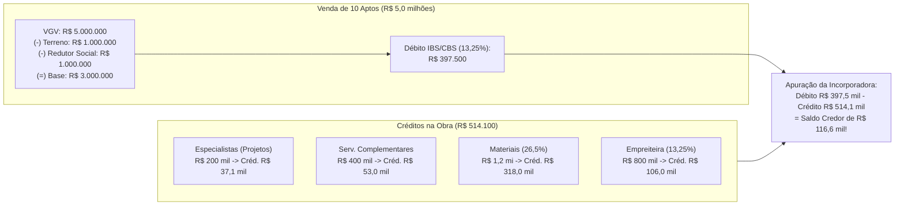
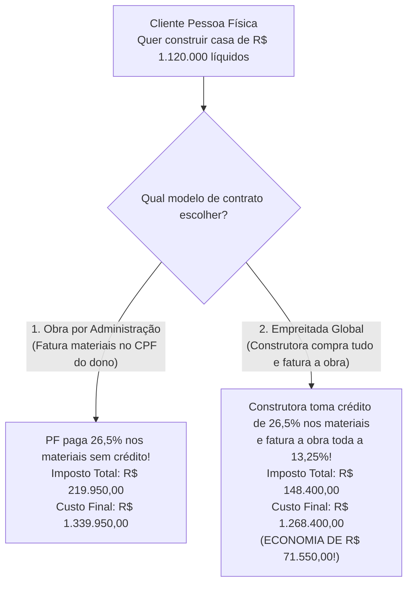

# Etapa 07.2 — 3 Exemplos Práticos Completos para Construção Civil

> **Base Legal:** Arts. 127 e 251 a 269 da Lei Complementar nº 214/2025.
> **Parâmetros de Referência dos Exemplos:**
> - Alíquota Padrão do IVA Dual: **$26{,}50\%$** ($8{,}80\%$ CBS + $17{,}70\%$ IBS)
> - Alíquota de Construção e Incorporação (Redução de $50\%$): **$13{,}25\%$**
> - Alíquota de Sociedades de Engenharia/Arquitetura (Redução de $30\%$): **$18{,}55\%$**

Abaixo estão **3 cenários reais completos** envolvendo **Incorporadora, Construtora, Empreiteira, Administradora de Obras e Especialistas/Serviços Complementares**, com desenhos, fluxogramas e memória de cálculo passo a passo.

---

## 🏗️ EXEMPLO PRÁTICO 1: Incorporação Residencial na Planta (Unindo Incorporadora + Especialistas + Empreiteira + Materiais)

### Cenário Real
Uma **Incorporadora** lança um pequeno edifício residencial com **10 apartamentos**, vendidos por **$\text{R\$ } 500.000{,}00$ cada** (Receita Total de Venda = **$\text{R\$ } 5.000.000{,}00$**).
Para erguer o prédio, ela teve os seguintes custos e contratações (valores líquidos sem IBS/CBS):
1. **Aquisição do Terreno (com ITBI):** $\text{R\$ } 1.000.000{,}00$ *(Vira Redutor de Ajuste da base de cálculo!)*.
2. **Especialistas (Projetos de Arquitetura, Cálculo Estrutural e Ambiental — Sociedade de Profissionais com redução de 30%, alíquota $18{,}55\%$):** $\text{R\$ } 200.000{,}00$.
3. **Serviços Complementares Especializados (Sondagem, Fundações Profundas, Impermeabilização e Elevadores/Instalações — redução de 50%, alíquota $13{,}25\%$):** $\text{R\$ } 400.000{,}00$.
4. **Compra de Materiais de Construção (Concreto, Aço, Blocos, Porcelanato, Louças — alíquota padrão de $26{,}50\%$):** $\text{R\$ } 1.200.000{,}00$.
5. **Empreiteira de Mão de Obra (Alvenaria, Reboco e Acabamento — redução de 50%, alíquota $13{,}25\%$):** $\text{R\$ } 800.000{,}00$.

### 1.1. Desenho Passo a Passo da Operação e dos Créditos

```text
===================================================================================
PASSO 1: CRÉDITOS GERADOS PELOS PARCEIROS DA OBRA (ENTRADAS DA INCORPORADORA)
===================================================================================
  [A] Especialistas (Projetos Arquitetura/Engenharia):
      Valor líquido: R$   200.000,00 x 18,55% (red. 30%) = R$  37.100,00 de crédito

  [B] Serviços Complementares (Sondagem, Fundação, Instalações):
      Valor líquido: R$   400.000,00 x 13,25% (red. 50%) = R$  53.000,00 de crédito

  [C] Materiais de Construção (Aço, Concreto, Acabamentos):
      Valor líquido: R$ 1.200.000,00 x 26,50% (padrão)   = R$ 318.000,00 de crédito

  [D] Empreiteira (Subempreitada de Alvenaria e Acabamento):
      Valor líquido: R$   800.000,00 x 13,25% (red. 50%) = R$ 106.000,00 de crédito
  ---------------------------------------------------------------------------------
  (=) TOTAL DE CRÉDITOS ACUMULADOS PELA INCORPORADORA:   = R$ 514.100,00

===================================================================================
PASSO 2: CÁLCULO DA BASE DA INCORPORAÇÃO (COM OS 2 REDUTORES LEGAIS)
===================================================================================
  (+) Receita Bruta de Venda (10 aptos x R$ 500.000):      R$ 5.000.000,00
  (-) Redutor de Ajuste (Custo do Terreno atualizado):   - R$ 1.000.000,00
  (-) Redutor Social (10 aptos x R$ 100.000,00 por apto):- R$ 1.000.000,00
  ---------------------------------------------------------------------------------
  (=) BASE DE CÁLCULO TRIBUTÁVEL DA INCORPORADORA:       = R$ 3.000.000,00

===================================================================================
PASSO 3: APURAÇÃO FINAL DO IBS + CBS DA INCORPORADORA
===================================================================================
  (+) Débito Bruto (R$ 3.000.000,00 x 13,25%):             R$   397.500,00
  (-) Créditos das Compras/Empreiteira/Especialistas:    - R$   514.100,00
  ---------------------------------------------------------------------------------
  (=) IMPOSTO LÍQUIDO ADICIONAL A PAGAR PELA INCORPORADORA: R$        0,00!
      (E ainda sobra Saldo Credor de R$ 116.600,00 para compensar em outras obras
       ou pedir ressarcimento!)
  ---------------------------------------------------------------------------------
  Carga Tributária Total de IVA em toda a cadeia do prédio:
  R$ 397.500,00 / R$ 5.000.000,00 (VGV) = APENAS 7,95% sobre o VGV total!
```

### 1.2. Fluxograma do Exemplo 1



---

## 🏭 EXEMPLO PRÁTICO 2: Construtora em Empreitada Global B2B + Empreiteira + Serviços Complementares (Construção de Galpão Industrial)

### Cenário Real
Uma **Indústria de Alimentos** contrata uma **Construtora** sob regime de **Empreitada Global** (material + mão de obra) pelo valor líquido de **$\text{R\$ } 2.000.000{,}00$** para construir um novo Centro de Distribuição.
Para executar a obra, a **Construtora** realiza os seguintes gastos líquidos:
1. **Compra de Materiais (Estruturas metálicas, concreto usinado, telhas térmicas — alíquota $26{,}50\%$):** $\text{R\$ } 900.000{,}00$.
2. **Empreiteira de Montagem e Alvenaria (subempreitada no regime regular — alíquota $13{,}25\%$):** $\text{R\$ } 400.000{,}00$.
3. **Serviços Complementares (Terraplenagem, Piso Industrial Polido e Instalações Elétricas/Incêndio — alíquota $13{,}25\%$):** $\text{R\$ } 200.000{,}00$.
4. **Mão de Obra Própria da Construtora (Engenheiro residente CLT + Margem de Lucro):** $\text{R\$ } 500.000{,}00$ *(não gera crédito de entrada)*.

### 2.1. Memória de Cálculo em Cada Elo (Empreiteira $\rightarrow$ Construtora $\rightarrow$ Indústria Cliente)

```text
+---------------------------------------------------------------------------------+
| ELO 1: EMPREITEIRA E SERVIÇOS COMPLEMENTARES (Faturam para a Construtora)       |
+---------------------------------------------------------------------------------+
| - Empreiteira cobra:        R$ 400.000,00 + R$ 53.000,00 (13,25%) = R$ 453.000  |
| - Serv. Complementares:     R$ 200.000,00 + R$ 26.500,00 (13,25%) = R$ 226.500  |
| -> Ambos destacam o imposto "por fora" e o Split Payment já garante o crédito   |
|    imediato de R$ 79.500,00 (53.000 + 26.500) para a Construtora!               |
+---------------------------------------------------------------------------------+
                                        |
                                        v
+---------------------------------------------------------------------------------+
| ELO 2: CONSTRUTORA (Apura seus Créditos e Fatura para a Indústria Cliente)      |
+---------------------------------------------------------------------------------+
| 1. Créditos da Construtora:                                                     |
|    - Materiais (R$ 900.000 x 26,50%):                       = R$ 238.500,00     |
|    - Empreiteira (R$ 400.000 x 13,25%):                     = R$  53.000,00     |
|    - Serviços Complementares (R$ 200.000 x 13,25%):         = R$  26.500,00     |
|    (=) TOTAL DE CRÉDITOS DA CONSTRUTORA:                    = R$ 318.000,00     |
|                                                                                 |
| 2. Faturamento da Construtora para a Indústria Cliente:                         |
|    - Preço Líquido da Obra:                                   R$ 2.000.000,00   |
|    - (+) IBS/CBS da Obra (13,25% por fora):                 + R$   265.000,00   |
|    - (=) Total da Nota Fiscal da Construtora:               = R$ 2.265.000,00   |
|                                                                                 |
| 3. Quanto a Construtora desembolsa de imposto próprio?                          |
|    Débito (R$ 265.000) - Crédito (R$ 318.000) = R$ 0,00 a pagar (e ainda fica   |
|    com R$ 53.000,00 de saldo credor porque os materiais vieram a 26,5%!).       |
+---------------------------------------------------------------------------------+
                                        |
                                        v
+---------------------------------------------------------------------------------+
| ELO 3: INDÚSTRIA CLIENTE (Dona do Galpão - Bem de Capital / Ativo Imobilizado)  |
+---------------------------------------------------------------------------------+
| - Paga a NF da Construtora: R$ 2.265.000,00                                     |
| - Toma CRÉDITO INTEGRAL de R$ 265.000,00 de IBS/CBS (Ativo Imobilizado da       |
|   atividade produtiva) para abater nas suas vendas de alimentos!                |
| - Custo Líquido Real do Galpão para a Indústria: R$ 2.000.000,00 (ZERO resíduo!)|
+---------------------------------------------------------------------------------+
```

> **Compare com o Sistema Antigo:** Antes da Reforma, a Construtora pagava ISS sobre a obra e não recuperava o ICMS dos $\text{R\$ } 900\text{ mil}$ de materiais. Todo aquele ICMS e ISS virava "custo morto" embutido no preço do galpão para a Indústria!

---

## 📋 EXEMPLO PRÁTICO 3: Administradora de Obras + Especialistas + Empreiteiras (Obra por Administração / Preço de Custo para Pessoa Física)

### Cenário Real
Um médico (Pessoa Física) já possui um terreno em condomínio fechado e quer construir sua casa de alto padrão. Em vez de contratar uma Empreitada Global fechada, ele contrata uma **Administradora de Obras** para gerenciar a construção pelo regime de **Obra por Administração (Preço de Custo)**, com uma **Taxa de Administração de $12\%$** sobre os gastos da obra.

Os gastos líquidos diretos da obra (todos faturados **diretamente para o CPF do dono da obra**) são:
1. **Especialistas (Escritório de Arquitetura + Design de Interiores + Paisagismo — alíquota $18{,}55\%$):** $\text{R\$ } 100.000{,}00$.
2. **Materiais de Construção comprados direto pelo CPF do proprietário (alíquota $26{,}50\%$):** $\text{R\$ } 500.000{,}00$.
3. **Empreiteiras e Serviços Complementares (Fundação, Estrutura, Elétrica, Piscina, Automação — alíquota $13{,}25\%$):** $\text{R\$ } 400.000{,}00$.
* **Custo Direto Líquido da Obra:** $\text{R\$ } 1.000.000{,}00$.
* **Honorários da Administradora de Obras ($12\%$ sobre $\text{R\$ } 1.000.000{,}00$):** $\text{R\$ } 120.000{,}00$.

### 3.1. Desenho de Como Funciona o Faturamento na Obra por Administração

```text
                     +------------------------------------+
                     |   PROPRIETÁRIO DA OBRA (MÉDICO PF) |
                     |   (Não é contribuinte - Uso próprio)|
                     +------------------------------------+
                        ^               ^               ^
       1. Fatura direto |               | 2. Fatura     | 3. Fatura APENAS a
          os materiais  |               |    direto os  |    Taxa de Administração
          e projetos    |               |    serviços   |    (R$ 120.000 + 13,25%)
                        |               |               |
        +---------------+---+   +-------+-------+   +---+--------------------+
        | FORNECEDORES (26,5%)| | EMPREITEIRAS  |   | ADMINISTRADORA DE OBRAS|
        | ESPECIALISTAS(18,55%)| | E COMPLEMENT. |   | Gerencia compras,      |
        |                   |   | (13,25%)      |   | cronograma e equipe    |
        +-------------------+   +---------------+   +------------------------+
```

### 3.2. Memória de Cálculo Completa (Quanto paga a Administradora e quanto paga o Dono da Obra?)

1. **Na Administradora de Obras (Art. 252, V da LC 214/2025):**
   - Base de Cálculo da Administradora = **apenas a sua Taxa de Administração** ($\text{R\$ } 120.000{,}00$). Os $\text{R\$ } 1.000.000{,}00$ de materiais e empreiteiros não passam pelo faturamento da Administradora!
   - Alíquota do serviço de administração de obras (redução de $50\%$) = **$13{,}25\%$**.
   - $\text{Débito de IBS/CBS da Administradora} = 120.000{,}00 \times 13{,}25\% = \mathbf{\text{R\$ } 15.900{,}00}$.
   - Se a Administradora teve despesas próprias no escritório (aluguel, softwares de engenharia, contabilidade, computadores) que geraram $\text{R\$ } 3.900{,}00$ de crédito, ela recolhe apenas $\text{R\$ } 12.000{,}00$ líquidos ao governo.

2. **No Bolso do Proprietário Pessoa Física (Custo Total da Casa):**
   - **Especialistas (Projetos):** $\text{R\$ } 100.000{,}00 + \text{R\$ } 18.550{,}00\text{ (18,55\%)} = \text{R\$ } 118.550{,}00$
   - **Materiais de Construção:** $\text{R\$ } 500.000{,}00 + \text{R\$ } 132.500{,}00\text{ (26,50\%)} = \text{R\$ } 632.500{,}00$
   - **Empreiteiras e Complementares:** $\text{R\$ } 400.000{,}00 + \text{R\$ } 53.000{,}00\text{ (13,25\%)} = \text{R\$ } 453.000{,}00$
   - **Administradora de Obras:** $\text{R\$ } 120.000{,}00 + \text{R\$ } 15.900{,}00\text{ (13,25\%)} = \text{R\$ } 135.900{,}00$
   - **Custo Total Desembolsado pelo Proprietário PF:**
     $$\text{Total Líquido (R\$ } 1.120.000{,}00) + \text{Total IBS/CBS (R\$ } 219.950{,}00) = \mathbf{\text{R\$ } 1.339.950{,}00}$$

---

### 💡 Descoberta Estratégica (Comparando Obra por Administração vs. Empreitada Global para PF!)

Olhe o que acontece se, em vez de o Proprietário PF comprar os materiais direto no CPF dele (pagando $26{,}50\%$ sem poder tomar crédito), ele contratar uma **Construtora por Empreitada Global** pelo mesmo valor líquido total de $\text{R\$ } 1.120.000{,}00$:

| Modalidade Contratual para Pessoa Física | Imposto Total Pago na Obra | Custo Final para o Cliente PF | Por que existe essa diferença? |
| :--- | :---: | :---: | :--- |
| **Obra por Administração** (PF compra os materiais direto no CPF a $26{,}5\%$) | **$\text{R\$ } 219.950{,}00$** | **$\text{R\$ } 1.339.950{,}00$** | Como o dono da obra é Pessoa Física, ele paga $26{,}5\%$ nos materiais e $18{,}55\%$ nos projetos e **não pode aproveitar o crédito**! |
| **Empreitada Global pela Construtora** (Construtora compra materiais e projetos, toma crédito e fatura tudo a $13{,}25\%$) | **$\text{R\$ } 148.400{,}00$** ($\text{R\$ } 1.120.000 \times 13{,}25\%$) | **$\text{R\$ } 1.268.400{,}00$** | A Construtora recupera o crédito de $26{,}5\%$ dos materiais e $18{,}55\%$ dos projetos e repassa toda a obra na alíquota reduzida de **$13{,}25\%$**! (**Economia de R$ 71.550,00!**) |


